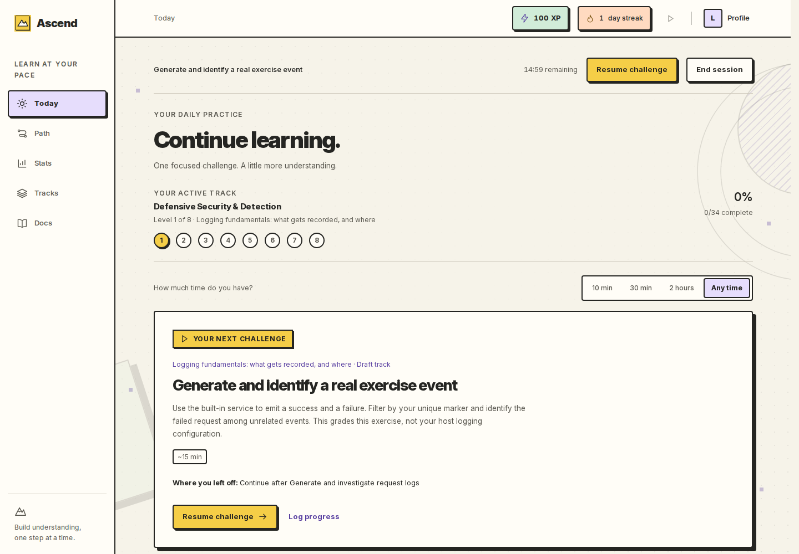

# Ascend

**Build skills, one small step at a time.**

Ascend turns learning roadmaps into guided challenges, daily practice, and visible
progress. Learn cybersecurity, infrastructure, DevOps, and more from your browser
or terminal, with your data stored locally.

[Quick start](#quick-start) · [Learning tracks](packs/community/) · [Documentation](#documentation)



## What you can do

- **Follow a learning path.** Work through practical challenges with clear goals,
  learning resources, and evidence checks.
- **Practice at your pace.** Use Playground for quick exercises, standalone
  challenges, and saved workspaces, or explore optional Linux labs.
- **See your progress.** Keep learning notes, build streaks, earn XP, and revisit
  completed work.
- **Make it yours.** Edit TOML learning tracks, choose light or dark mode, and
  enable optional reminders.

## Quick start

Requires **Python 3.11+**. From the repository root:

```sh
python3 -m venv .venv
source .venv/bin/activate
pip install -e '.[server]'
ascend-server
```

Open **[localhost:8420/app](http://127.0.0.1:8420/app)**, choose a track, and start
your first challenge. Stop the server with `Ctrl+C`.

Progress is stored in SQLite under `~/.config/ascend/`. Set `ASCEND_HOME` to use
another directory. The default server runs locally in single-user mode.
For Docker, phone access over HTTPS, or multiple accounts, see the
[deployment guide](docs/deployment-guide.pdf).

### Prefer the terminal?

The standalone CLI needs no server and has no runtime dependencies. For a CLI-only
installation, use `pip install -e .` in the virtual environment above.

```sh
ascend pack install networking-for-security
ascend mission start networking-for-security
ascend
ascend done "I explained what I learned" "Try the next exercise"
ascend stats
```

`ascend` shows your next task. `ascend done` logs progress; add `--complete` when
ready to run the task's checks and mark it complete. Use `ascend --help` for more
commands.

Bundled tracks are editable drafts. Review your private copy before enabling
executable checks with `ascend pack trust <id>`. Editing a pack resets its trust.

## Documentation

| Guide | What's inside |
| --- | --- |
| [User guide](docs/user-guide.pdf) | Tracks, Playground, labs, progress, and reminders |
| [Command reference](docs/command-reference.pdf) | CLI commands and options |
| [Deployment guide](docs/deployment-guide.pdf) | Installation, Docker, accounts, HTTPS, and backups |

[MIT License](LICENSE)
