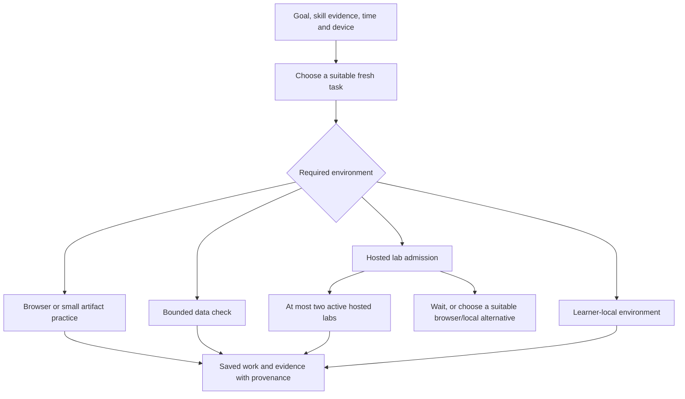

# Adaptive Playground within two hosted lab slots

**Design proposal, 2026-11-03.** Based on the [eight-platform audit](adaptive-playground-platform-audit.md) and the current working tree. The owner confirmed: **keep two simultaneous hosted labs; use browser/local practice for others**. The starting planning budget remains an 8 GB RAM / four-core host and 80 GB disk. These are planning constraints, not a measurement of the deployed server's spare capacity.

This document proposes the next implementation. The research does not implement an adaptive engine, change scoring, provision infrastructure, or establish that Ascend already provides the flows below. Existing Playground and runner work continues to be described in the [Playground plan](practice-playground-plan.md), [UX follow-up](practice-playground-ux.md), and [runner design](server-lab-runner.md).

The recommendation is to build **one practice system with independent choices for goal and challenge level**, backed by small, substantial cases. An experienced newcomer should reach useful work immediately; a new learner should get a clear demonstration. Allocate a hosted environment only when the learning objective needs one.

## Current baseline and gaps

This is a snapshot of a shared, uncommitted working tree. The [source ledger](adaptive-playground-sources.json) includes hashes of relevant files so later edits can be distinguished from the audited state.

| Area | Present behaviour | Required next change |
| --- | --- | --- |
| [Readiness engine](../../ascend/engine/practice.py) | Tracks evidence per skill. Two distinct independent passes with transfer evidence support `demonstrated`; examples and weaker evidence have lesser states. | Add a provisional starting level and evidence by difficulty/skill. Unknown history must not force a competent newcomer through all basics. |
| [Recommendations](../../ascend/playground/__init__.py) | Default recommendation pool is `kind="quick"`; readiness gates, misses, review, repetition, and time affect selection. | Include suitable standalone challenges for experienced users and explain each recommendation. |
| Feedback | The engine down-ranks an activity marked too hard or an unwanted repeat. **Too easy does not currently escalate challenge.** | Use explicit difficulty feedback to select the next task, without treating feedback alone as mastery evidence. |
| [Catalog](../../ascend/playground/catalog.py) | 37 activities: seven examples, 18 other quick activities, ten standalone challenges, two workspaces. There are eight intermediate and **one hard** activity overall. | Author enough meaningfully different cases to support practitioner progression. Reordering this catalog cannot supply indefinite expert novelty. |
| UX and timing | Dedicated activity pages and worked-example tours exist. Assessed Playground clocks continue through save/navigation; examples and free practice have pausable sessions. | Preserve those contracts. Add optional starting-level checks and clear outcomes, not more catalog controls inside an active task. |
| [Hosted runner](../../ascend/local_labs/hosted.py) | Seven reviewed recipes, two active account slots by default, one active run/account, two-hour absolute lifetime, no warm pool, 10 GiB free-space reserve. Full slots reject new starts. | Add fair waiting and resource admission. Separate slow provisioning from another run's interactive operations. |
| Runner execution | One executor worker and a global operations lock serialize start/check/save/HTTP/router operations. Status reads remain available. Stopped or failed-cleanup runs retain capacity. | A second thread alone will not remove the global-lock bottleneck. Scheduling changes must retain per-run ordering and lifecycle ownership. |
| Evidence | Hosted lab checks currently award zero XP and no verified track completion. Learner-local/manual observations have weaker authority. | Keep evidence provenance visible. A running service or a passing control does not by itself establish independent solving. |

## 1. Separate why someone learns from what they can currently do

Offer a small, optional preference panel that can be changed later:

| Preference | Choices and behaviour |
| --- | --- |
| Goal | **Prepare for a job**, **Explore interests**, or **Both**. Job preparation can add a role and optional target date. Exploration can add topics or a question to investigate. |
| Background in this subject | **New to this**, **Know the basics**, **Practise regularly**. This sets an initial suggestion, not a certified level. |
| Today's session | Available time, device, and whether the learner wants normal practice or a stretch. Keep existing settings as defaults. |

These are preferences over the same catalog and evidence. They do not create multiple active tracks, reset progress, or assume a hobbyist wants easy work. Job-focused users can explore; experienced users can request an explanation. A role plan is a coverage view over relevant activities, not an automatic track switch.

**Job preparation:** recommend work against explicit role skills, surface gaps, and build a small portfolio of practical results. A useful outcome is a reviewed incident analysis, tested repair, or reproducible project change. Show covered and unassessed skills separately. Offer supported role coverage only where activities actually exist; the first two-family pilot is partial preparation, not a complete analyst curriculum. An interview-preparation task can have a fixed time budget when its rubric requires it, but job preparation need not make every practice task timed.

**Interest-led learning:** let the learner choose a topic, investigate a “why,” follow an adjacent concept, or keep a project going. Make the next experiment useful even when no review is due. A formal report is optional unless that activity's objective is reporting.

**Both:** use the same evidence to show how an interesting case contributes to a role goal. Do not duplicate the work or its reward just because it appears in two views.

## 2. Give the six-month practitioner a clear entry route

For someone choosing “Practise regularly,” the primary actions should be:

- **Find my starting level** — a short, optional practical diagnostic.
- **Choose an intermediate challenge** — direct catalog entry with background requirements visible.
- A quieter **Review an example** option when they want instruction.

The diagnostic's initial content budget is **three short probes and one changed-condition task**, aiming for **8–12 minutes** in one selected subject. This duration is an authoring target to validate, not a claim that four probes can measure an entire profession. It samples only a few relevant skills and can be ended early with an incomplete/provisional result.

For an HTTP investigation, probes could ask the learner to compare two requests, choose a discriminating log observation, and recognise an authorization boundary. A fourth task changes a meaningful condition. Use structured evidence or bounded data evaluation; vocabulary recognition alone cannot establish practical diagnosis.

Each probe has a fixed brief and rubric once opened. Selection can change between completed probes. This is a new low-stakes diagnostic purpose with an elapsed-time display and no first-solve XP or automatic curriculum completion. It does not replace the clocks or final results of existing assessed challenges.

A useful result would say:

> Start with intermediate access-control investigations. Your request comparisons were sound. Evidence ordering needs another check. Networking was not assessed.

Follow it with **Start recommended challenge**, a short explanation, and optional targeted preparation. Do not display “You are 78% job ready.” Until enough fresh evidence exists, label the starting suggestion **provisional**. A declared background or one short diagnostic pass is enough to offer a useful stretch, but not to certify mastery across all prerequisites.

If the person directly selects a harder challenge, retain the existing explicit “Try this challenge” route and the original difficulty. No preparatory example should open automatically in that route. If they choose a worked example, preserve the first-example tour behaviour and **Skip tour**; subsequent examples should offer guidance where useful rather than forcing the entire introduction again.

### Example session

An intermediate learner interested in an analyst job declares prior HTTP/Linux practice. They take the short check or go straight to an intermediate case. The case asks for the cause, two supporting observations, and a test that separates competing explanations. An independent fresh success plus “too easy” leads to a case with an additional interacting constraint; a weak timeline result leads to a targeted timeline exercise. Neither result changes their untested BGP proficiency.

A curiosity-driven learner with the same evidence can take the same case, then investigate “What changes if this credential rotates?” Their progress remains useful if they later select a job goal.

## 3. Use explainable adaptation before a statistical model

Start with authored difficulty bands and a few named dimensions: required knowledge, number of interacting constraints, ambiguity of evidence, and degree of guidance. Increasing difficulty does not have to mean a longer task or more containers. Guidance level alone also does not define conceptual difficulty: an advanced worked example can teach a difficult technique.

Keep **content difficulty**, **learner evidence**, **familiarity**, and **runtime cost** independent. A difficult artifact investigation can be cheap; a beginner GUI VM can be expensive.

### Evidence required

Extend the existing event model rather than storing one opaque global level. Record account, skill/rubric component, difficulty band, activity/family/variant version, result, assistance/reveal history, meaningful transfer, evidence authority, technical failures, and feedback. Treat elapsed time as context for estimates only; speed, idle time, repeated clicks, or time spent on another page do not establish ability.

Use four kinds of information explicitly:

| Information | Use | Limit |
| --- | --- | --- |
| Declared experience and interests | Choose a provisional entry point and make useful choices visible. | Not a pass or a verified skill. |
| Diagnostic observations | Suggest a starting band for the sampled skills and identify gaps. | Sparse coverage; keep uncertainty visible. |
| Fresh, independently completed rubric components | Support stronger recommendations for those skills and bands. | “Independent” means no recorded assistance/reveal under this product's rules, not proctored proof that no outside help existed. |
| Familiar/assisted/local-manual work | Record practice, reflection, and relevant next steps. | Do not silently give it the same authority as a fresh server-checked assessment. |

As an initial rule, stronger readiness at a band needs **two passed, meaningfully distinct cases for that skill, including a successful transfer task**, with eligible evidence and no solution reveal. A failed transfer cannot contribute positive transfer evidence. A new seed, filename, or shuffled answer order alone does not make a case distinct. Apply any new policy prospectively and version it; retain old results and awards.

The current review schedule can remain a useful input. Being due for review raises uncertainty and offers a recheck; it must not erase a past achievement or force the whole beginner path after inactivity.

### Initial selection policy

Apply these rules **between attempts**. Freeze the selected scenario, rubric, assessment timer policy, seed/version, and reward contract for an attempt.

| Signal | Next recommendation | Do not infer |
| --- | --- | --- |
| Unknown history + declared regular practice | Offer a diagnostic or a provisional intermediate independent case with clear prerequisites. | That the learner is a beginner, or already has demonstrated mastery. |
| Fresh independent success + “too easy” | Offer one higher difficulty step or one extra reasoning constraint, provided other prerequisites are supported. | More knowledge merely from the feedback. A single easy task is not proof of expert ability. |
| “Too easy” without a verified fresh success | Let the learner choose a stretch or take a short check; record the preference. | A promotion in demonstrated skill or an extra award. |
| Two distinct successful cases including transfer | Recommend a higher step for the demonstrated skills; leave unrelated skills unchanged. | Global expertise. |
| Incorrect conceptual result | Offer a relevant retry/contrast case and explicit help; after repeated similar errors offer a separate example or easier task. | That one miss invalidates all prior success. |
| Setup failure or unclear instructions | Offer setup help or another usable task; flag the content issue. | A conceptual failure, lower skill, or a need for beginner remedial work. |
| “Bored / already seen this” | Prefer a different mechanism, family, or supported subject. Label unavoidable repeats. | That cosmetic variation is novelty. |
| Worked example or solution reveal | Recommend a separate fresh application task. | An independent solve of the revealed scenario. |
| Returning after a gap | Offer a brief warm-up or recheck at the last supported band. | Lost achievements or a mandatory restart. |

The selector first respects the learner's subject, time/device constraints, prerequisite evidence or explicit provisional route, and known reveal history. It then chooses among an appropriate next challenge, a specific gap/review, and an optional exploration branch. Show one primary recommendation and a small number of useful alternatives, with a reason such as “You solved two access cases independently; this adds a conflicting audit trail.” For a blind mixed-topic mystery, explain prerequisite coverage without revealing its diagnosis. Provisional entry can suggest a scoped independent task; automatic mixed-topic mysteries still require supported constituent skills unless the learner explicitly chooses a manual stretch.

Resource admission happens after selecting educationally suitable candidates. If the chosen live lab is busy, retain it and offer another **similarly demanding** browser/local activity. Do not quietly substitute easier work because the server is full.

If no suitable fresh case exists, say so. Offer labelled familiar practice, a different skill, a project, or a learner-local task. A recommender cannot generate validated expertise-level material from missing content. Revisit calibrated item-response models only after collecting sufficient representative item/learner data and showing an improvement over these explainable rules; no model-serving GPU or per-attempt LLM call is required for the initial system.

## 4. Practitioner ideas to test after the research

These are proposed combinations and brainstorming, not claims that competitors lack them or that retention will improve. Prioritise the first three because they fit current data/runner capabilities.

| Idea | Concrete learner task | Why a practitioner may find it useful | Delivery and validation |
| --- | --- | --- | --- |
| **Counterexample clinic** | A plausible fix passes the obvious test. Find the smallest input that breaks it, then repair it while preserving valid behaviour. | Tests judgment and edge cases instead of recall. | Browser/data or bounded worker. Verify both the counterexample and positive/negative controls with an authored reference evaluator. |
| **An investigation with a test budget** | Select a few observations from a documented evidence menu, distinguish two plausible causes, and justify the conclusion. | Rewards efficient diagnosis without equating fast typing with skill. | Small authored datasets. Publish the test-budget rule before starting; provide enough information for at least one valid strategy. No arbitrary hidden constraints. |
| **Changed-condition follow-up** | After finishing a case, try a fresh case where one important assumption changes: ownership, trust boundary, time ordering, or an allowed workflow. | Checks transfer and makes later return visits meaningful. | New versioned fixture and result. It is a separate attempt; never alter the completed case's success criteria. |
| **Investigate, repair, review** | Solve an incident, patch the cause, then review a different proposed patch for regressions. | Exercises several professional roles and standards of evidence. | Reuse a pinned recipe but use separate case versions. Familiarity with earlier stages remains recorded; do not award three blind discoveries of one known answer. |
| **Short live phase inside a substantial case** | Inspect the brief and plan tests in the browser; acquire a lab for the operations requiring it; export evidence and finish analysis after releasing compute. | Keeps the reasoning substantial while reducing time occupying a machine. | Only for cases whose stages are separable. Explicit checkpoints and reliable export are required. Longer uninterrupted labs remain available where the objective needs them. |
| **Follow a question** | From a solved case, investigate a related “why” through a small reversible experiment rather than starting another full course. | Supports curiosity and builds connections between skills. | Authored links to supported adjacent concepts; optional worked examples for unknown prerequisites. No automatic blind jump into an unintroduced subject. |
| **A case handoff** | Resume a compact evidence bundle later or review an anonymised, consented alternative solution after ending the assessment. | Develops explanation, review, and continuity across short sessions. | Save small artifacts and observations rather than full machines. Human-reviewed claims remain distinct from automatic checks; sharing needs a real opt-in workflow. |
| **Build and defend a variant** | Design a new failure, expected result, and regression tests; have it reviewed before others receive it. | Gives experienced learners design and communication challenges while expanding content. | Start with admin-reviewed data-only contributions. Validate solvability, ambiguity, leakage, license, and resource envelope. Do not execute arbitrary submitted code on the web server. |

### First content slice

Build a coherent ladder for **two existing skill families**, such as access control and log/timeline reasoning, before promising adaptation across every domain. For each family, author a teaching example, a practical probe, and independent tasks at three reasoning levels. Each level needs at least two meaningfully distinct cases, one with transfer; these are minimum coverage for a pilot, not an endless content supply.

Examples include an authorization repair that keeps the owner's legitimate request working; a log sequence with a benign alternative explanation; and a changed trust boundary that invalidates a previously sound fix. Later Python cases can use bounded file/policy data and regression checks. 3D cases can use scene graphs and client rendering where appropriate; full Blender execution or GPU rendering remains learner-local until separately reviewed.

Author metadata should identify objective, prerequisite abilities, targeted rubric components, difficulty dimensions, estimated preparation/work time, assistance policy, novelty family, variant version, and required environment. Private answer/rubric material stays outside public brief metadata. Every generated variant must satisfy reference-solver and negative-control checks; sample or review the narrative quality too. Do not ship an unbounded procedural generator and assume all combinations make good problems.

## 5. A clear interface for goals, practice, and active work

Use the existing Playground landing page for selection. Give it a goal preference, one recommended activity, and an experienced-entry action. Distinguish learning examples, independent challenges, and free work through action wording, layout, and outcome—not solely through colour or a small difficulty badge.

| Surface | What the learner should understand |
| --- | --- |
| Worked example | “Learn this technique.” Display the steps, the demonstration's outcome, and the optional tour. |
| Independent challenge | “Diagnose / repair / produce this result.” Display prerequisites, expected evidence, work/setup estimates, and assessment timing before start. |
| Free practice | “Explore this workspace.” Display what can be changed and how work is saved, without inventing a scored finish line. |
| Active task page | A separate route showing brief, workspace, evidence/results, timer where applicable, and save/finish actions. Catalog category cards stay on the catalog page. |
| Completion | Explain what the result established and give a named next action, such as “Try the changed-ownership case,” rather than an unexplained “Next step.” |
| Saved work | “Saved to Playground → My work.” Provide a visible artifact list and **Download a copy** for saving to the learner's device. Confirm the actual persistence state; do not imply a browser download happened when work was saved on the server. |

For job preparation, the completion view can offer a work-sample summary with task/version, artifact, observed controls, assistance, evidence authority, and remaining limitations. For exploration, offer a concrete next experiment. Both can resume previous work without changing the active learning track.

## 6. Separate educational selection from compute admission

| Tier | Use | Server work and limits |
| --- | --- | --- |
| Browser/artifact | Evidence inspection, scene/policy visualisation, choosing tests, prediction, report drafting. | Mostly static assets plus bounded API reads/writes. Client computation is untrusted; scored outcomes require the appropriate server check. Serving many clients still needs load testing. |
| Bounded data worker | Validate a small policy, compare structured evidence, run fixed reference logic on input data. | Short-lived reviewed evaluator with payload, time, memory, and queue limits. The existing policy worker is a precedent, not a sandbox for arbitrary learner code. Initially keep any new worker concurrency at one. |
| Scoped hosted lab | Actual services or router behaviour needed for an authored objective. | Existing separate runner and seven reviewed recipes; at most two active runs, one per account. No general shell or Docker socket in the web process. |
| Learner-local/specialist | Long experiments, full toolchains, VM/cluster/emulator/cloud/model environments. | Download/setup and small work/result sync. Capability gates and evidence labels remain. Local observations cannot silently become server-verified results. |

The seven reviewed runner recipes are audit discovery, the BGP export policy model, VAmPI ownership, WrongSecrets basics, and the three FRR BGP exercises. Heavy candidate environments remain subject to their [existing acceptance gates](shared-lab-runner-evaluation.md). A general infrastructure orchestrator or a shared full desktop per learner is unnecessary for the first adaptive content slice.

Today, even a hosted file/model recipe occupies a runner slot while its run is retained. Moving a suitable check into a short-lived queue without a persistent instance requires a new reviewed adapter. It is a proposed change, not capacity already available from the current hosted API.

### What the repository measurements establish

These are recorded individual runs, not a concurrency benchmark or SLA. Memory peaks below have different scopes and should not be compared as identical whole-host measurements.

| Environment | Recorded evidence | Capacity implication |
| --- | --- | --- |
| BGP data-policy worker | About **10.8 MiB** peak; sampled CPU **0.016–0.030 seconds**; configured **128 MiB address-space, 2 CPU seconds, 5 wall seconds, zero child processes**, no persistent worker. [Measurement](../testing/local-prefix-measurements.json) | Rich policy reasoning can use little compute. New rule/fixture bounds need their own worst-case tests. |
| VAmPI | Sum of measured container peaks about **158 MiB**; **320 MiB** steady container memory caps and **1.25 CPU** total; recorded local cold/warm starts **42.74 / 2.11 seconds**. [Measurement](../testing/local-vampi-measurements.json) | Small persistent target, but startup and helper containers add lifecycle cost. |
| WrongSecrets | About **427 MiB** measured peak; configured target/proxy caps total **832 MiB**, **1.25 CPU**; local cold/warm starts **257.54 / 13.62 seconds**. [Measurement](../testing/local-wrongsecrets-measurements.json) | Cache state and image acquisition materially affect launch latency. |
| Real FRR BGP | **128 MiB / 0.5 CPU per router**; two- or three-router cases therefore cap at **256–384 MiB / 1–1.5 CPU**. Recorded summed peaks are about **33–54 MiB**, sampled after stop/resume in the verification script, not guaranteed full-lifecycle maxima. [Measurement](../testing/local-bgp-measurements.json), [script](../../scripts/verify_bgp_labs.py) | Reserve from reviewed limits and lifecycle evidence, not the small post-restart sample. |
| Hosted launch integration | Recorded launches: policy **0.281 s**, FRR **2.548–2.986 s**, audit **0.047 s**, VAmPI **135.51 s**, WrongSecrets **512.498 s**. The test used **zero** reserve; production keeps **10 GiB**. [Measurement](../testing/hosted-lab-measurements.json) | Do not advertise a uniform instant launch. The single operations worker can block another learner during a multi-minute acquisition. |

The web Compose service is capped at **512 MiB / one CPU**. The runner service has **768 MiB** `MemoryMax`, but Docker container memory is **additional**. [Compose](../../docker/docker-compose.yml), [runner service](../../deploy/ascend-lab-runner.service)

### Proposed resource accounting

Keep the two-slot limit. Add resource reservations rather than inferring capacity from a count alone. A start must pass slot, per-account, recipe, disk, and reviewed memory/CPU checks atomically. Starting, stopped, and cleanup-failed resources remain accounted for until their release is confirmed.

For scale, two WrongSecrets runs' configured steady caps sum to **1,664 MiB**. Adding the web and runner service caps gives **2,944 MiB**. That is not whole-host peak usage: Docker/OS, startup helpers, image extraction, page cache, tmpfs, files, and other services still need headroom. An initial **3 GiB aggregate lab-memory reservation budget plus 2 GiB host allowance** is a proposed conservative envelope within an 8 GB host; measure it on the intended host before treating it as sufficient. Account tmpfs in memory rather than treating it as free disk.

CPU is a separate constraint. Two three-router cases can reach **three CPUs of lab quota**; adding the web's one-CPU quota exhausts a four-core planning budget before runner/host work. Initial admission should budget at most **2.5 CPUs of aggregate steady lab quota** when web and runner share that physical budget. Some recipe pairs would therefore wait despite a nominal spare slot. Alternatives are tested lower recipe quotas or a tested shared lab CPU cap. Do not silently lower a running assessment's limits or claim every pair fits merely because the memory fits. Separately account transient launch helpers and allow only one provisioning job at a time. Any new bounded-check worker must draw from explicitly reserved headroom too; it cannot become an unaccounted additional compute pool.

An illustrative disk envelope for **80 decimal GB ≈ 74.5 GiB** is below. This refines planning, not actual filesystem usage or an already enforced quota:

| Budget | GiB |
| --- | ---: |
| OS, Docker, web/runner data, and bounded logs | 12 |
| Reviewed image/download cache | 12 |
| Active writable lab storage | 8 |
| Saved artifacts and result history | 4 |
| Required free-space reserve | 10 |
| Unallocated headroom | 28.5 |

Admission must check actual filesystems, aggregate reservations, and acquisition/extraction needs. Shared image layers are accounted once; unused cache can be pruned only when no owned or pre-existing protected run needs it. No warm pool initially. Retain reviewed images within the cache budget to reduce cold starts; prefetch them as an operator maintenance action before offering a new recipe, not as an unbounded response to browsing.

For saved work, retain the existing small-file interface and propose a **64 MiB per-account** quota within the global artifact budget. Show usage, download, and deletion controls before enforcing it. Keep essential results distinct from expendable runtime logs. Do not automatically discard a learner's saved work to admit another lab, or upload VM disks, weights, credentials, and full local repositories as practice evidence.

### Fair waiting and responsive running labs

The current runner has a queue for accepted **operations**, not a waiting queue for full **lab slots**. Add a durable admission queue with one ticket per authenticated account, separate from operation jobs. The runner owns reservations; the web stores the ticket reference rather than maintaining a competing capacity counter.

Start with strict FIFO, no priority based on XP or career goal, and a configurable initial cap of **20 waiting accounts**. Allow an account one outstanding ticket or one active hosted run. Only queue recipes that can fit the host when capacity is free. If the head request cannot fit alongside a current run, it waits; this initial policy trades some utilisation for predictable fairness. Reconsider bounded backfilling only after measuring waits and starvation risk.

A **90-second in-app offer** provisionally reserves admission capacity and lets the learner claim the slot; no VM is launched merely because they entered the queue. An expired offer releases that reservation and the learner can rejoin, with saved work unaffected. Cancellation, claims, and retries are idempotent. Claiming a slot still obeys the existing foreground-assessment rule; a queue offer cannot silently end or reset another scored attempt.

Show **Waiting → Preparing → Ready → Running → Exporting → Released** with recoverable failure/cleanup states. Report a position or a wait range only when supported by current data. A capacity failure is not “page not found.” Keep the selected challenge visible with **Wait**, **Run locally**, and a named browser alternative of suitable difficulty. Notifications are in-app; this proposal does not enable email or messaging integrations.

Before a new assessed attempt starts, complete availability/preparation checks and show the finish line and timing contract. Waiting and image download should occur in this preflight. Already started scored attempts retain their original continuous clocks; the runner's absolute resource deadline is a separate, preserved lifecycle limit.

For operation responsiveness, move slow acquisition/provisioning to its own bounded lane. Use per-run mutation locks and a small interactive worker pool, with a brief global reservation lock and appropriate shared image/cache locks. Preserve ordered save → check semantics, revision checks, cleanup exclusion, restart reconciliation, and the private account boundary. Expiry must not wait indefinitely behind a download. Implement this deliberately; merely increasing `ThreadPoolExecutor.max_workers` while leaving the global operations lock is insufficient.

Stopping a lab currently retains its slot and absolute deadline. The interface must explain that distinction from **Finish & keep work**, which exports and destroys the runtime. Failed export keeps the runtime; failed cleanup keeps inventory and capacity occupied until retry succeeds. A future suspend feature must prove it can reconstruct all required state before it claims to release and resume a lab.

### Two slots limit throughput, not the number of registered learners

If an authored case occupies a lab for 15 minutes plus three minutes of startup/cleanup, the ideal ceiling is `2 × 60 / 18 ≈ 6.7` lab sessions/hour. A 60-minute live phase plus the same overhead gives about `1.9` sessions/hour. These are arithmetic examples, **not measured service rates**; cold pulls, serialized operations, failures, and burst arrivals reduce them. This is why separating reading/analysis from the live phase can help.

Browser/local practice can continue during those waits, subject to web/API load limits. Do not convert small per-run measurements into a promise of hundreds of concurrent learners. Admission telemetry and load tests must establish the useful limit.

## 7. Implementation order and completion gates

The audit and budget decision are complete. The implementation milestones below are proposed work, in sequence. Each has a usable result and a specific acceptance gate; none requires replacing the existing scoring or importing a generic orchestrator.

| Milestone | Deliverable | Completion gate |
| --- | --- | --- |
| **1. Experienced entry** | Goal/background preferences, direct challenge entry, new diagnostic purpose, sampled per-skill provisional results. | A new regular practitioner reaches appropriate work without completing a beginner track. A new learner gets clear preparation. Goal changes preserve active track, history, clocks, and awards. Diagnostic failure/reveal/retry cannot fabricate completion. |
| **2. Explainable next-task selection** | Versioned evidence rules, challenge-inclusive recommendations, meaningful too-easy/too-hard/repetition responses. | Table-driven selection cases cover cold start, provisional entry, conflicting skills, assisted/familiar work, failed transfer, technical errors, sparse content, and manual stretch. Refresh/concurrent requests cannot change an active task's contract or double-award it. |
| **3. First practitioner case pack** | Two skill families with probes, examples, three challenge levels, distinct cases/transfer, and the first three brainstorming formats. | Every case has clear finish criteria, valid positive/negative controls, no answer leakage, and measured work/setup estimates. A practitioner can find a fresh harder next case; exhaustion is labelled honestly. No arbitrary learner code executes in the web process. |
| **4. Reliable two-slot service** | Admission queue, reservations, cold-start status, per-run operation ordering, bounded separate provisioning, export/release flow. | Three-account contention and two-tab races never exceed limits. A slow launch does not stall another run's bounded interaction. Queue fairness, low disk, timeout, export failure, failed cleanup, restart, expiry, and cross-account isolation have explicit tests. |
| **5. Goal-specific continuation** | Role coverage/work-sample view, curiosity branches, named next steps, optional recurring practitioner cases. | The same evidence serves either goal without duplicate awards. Work samples label what was actually checked. All relevant UI flows work with keyboard and narrow screens; saving location and runtime release are clear. No competition is mandatory. |
| **6. Pilot and resource calibration** | Learner sessions, representative mixed load, measured budgets, content/recommendation revisions. | Meet the learning and operational gates below before making wider capacity or adaptation claims. Publish measured limits and the remaining weak areas. |

### Technical integration boundaries

Extend the pure engine under `ascend/engine` for selection rules and the shared application layer for preferences, diagnostics, and evidence. Use additive, account-scoped migrations chosen against the current migration sequence; another session is editing the workspace. Do not overwrite private installed packs or rewrite historical attempts to satisfy new readiness rules.

Catalog metadata, fixture generation, public/private presentation, browser routes, and CLI output must agree on activity purpose. Introduce a small environment-requirements record and a runner reservation manifest based on reviewed recipe limits. Keep answer keys and raw infrastructure identities out of public catalog responses. Record recommendation reasons/version for debugging, with bounded retention rather than large event streams on every keystroke.

New tests should cover consequential logic and lifecycle races, not duplicate prose or every reversible label change. Existing timing, idempotence, assistance/reveal, active-session, and evidence-authority checks are regression gates for the relevant implementation milestones. This research-only change does not require restarting services or rerunning application test suites.

### Learner and operational validation

Recruit a small formative group across beginner, approximately six-month practitioner, and advanced backgrounds, including both employment and interest motives. Start with roughly **12–18 sessions** across these combinations; this is a usability/content pilot, not enough to prove statistical retention gains. Add a delayed fresh transfer task after one to two weeks. For longer-term comparisons, report cohort sizes, uncertainty, and which content changed rather than attributing every return visit to adaptation.

| Question | Measure and initial gate |
| --- | --- |
| Can learners tell what to do? | Without coaching, identify the action, evidence/finish line, and save location. Revise any case with repeated misunderstanding before wider release. |
| Can experienced users enter appropriately? | Track time from entry to useful independent work and unnecessary beginner detours. Target a direct route immediately, or a diagnostic within its validated estimate. |
| Does adaptation help? | Compare too-easy/too-hard reports, recommendation overrides, fresh independent success, and delayed transfer by skill/background. A higher completion rate alone can mean the work became too easy. |
| Is practitioner practice worth returning to? | Track substantive return sessions, fresh case coverage, repeat fatigue, and voluntary exploration. Report assisted learning and independent outcomes separately; use day-7/day-28 return as context rather than the sole objective. |
| Does job preparation produce useful evidence? | Review the quality and reproducibility of a role-aligned work sample. Track coverage of named skills; do not infer employability or hiring outcomes from XP. |
| Can two labs coexist with normal use? | On the intended host, test both recipe orderings, cold/warm acquisition, representative check/write bursts, and **two active labs plus a proposed 30 browser-client load**. Thirty is a test target, not an advertised capacity. |
| Are responsiveness and resources acceptable? | Initial targets: ordinary read API p95 under **500 ms**, bounded interactive lab-operation queue wait p95 under **2 s** outside its own run's long check, no web OOM or swap thrashing, free disk above reserve, and no leaked owned resources after repeated lifecycle tests. Measure on the actual deployment network and report workload/rate. |
| Is capacity access fair? | Measure queue age/wait distributions, abandonment, expired offers, and cleanup-blocked slots; verify no user can monopolise tickets or bypass per-account limits. |

If a target fails, first reduce live occupancy, repair scheduling, tighten content/resource bounds, or route the relevant activity locally. More expensive infrastructure is a later decision, not the default way to make a challenge intellectually harder.
