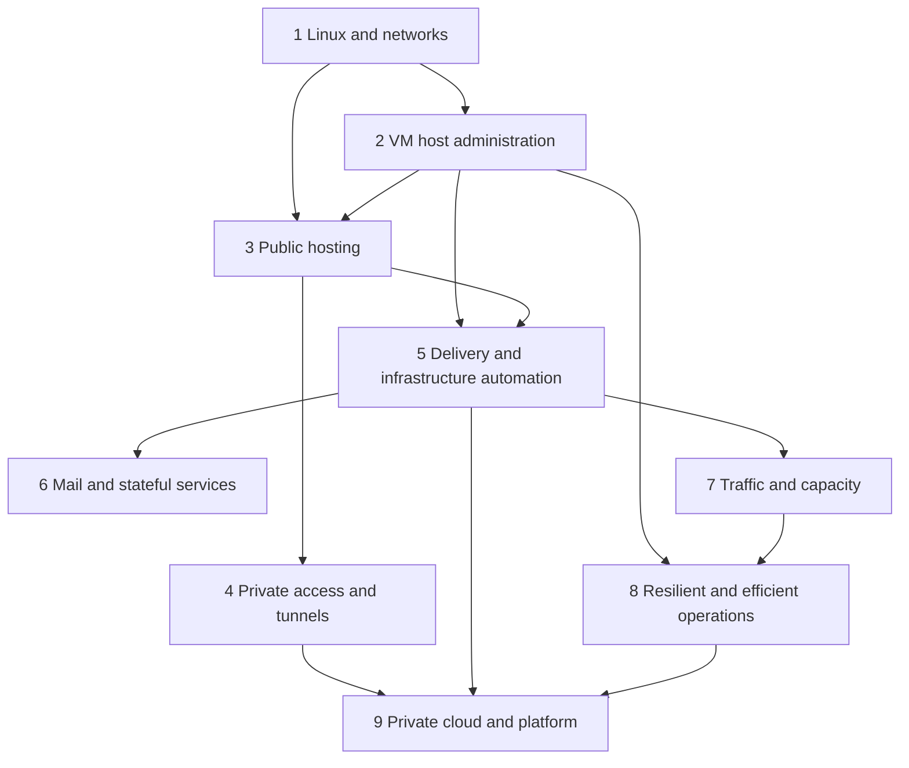

# Infrastructure & Internet Operations: the Local to Internet domain

**Domain and practical curriculum design, 2026-11-03.** This expands the [DevOps foundations plan](devops-track-design.md) into a connected domain covering networking, Linux operations, virtualization, self-hosting, delivery, and site reliability engineering. The scope includes the user's later requirements for Raspberry Pi and alternative devices, host administration of guest VMs, and sequential tracks with room for advanced practice.

The intended result is a learner who can **build a service, explain its path from a client, publish or privately expose it, administer the machines underneath it, measure its limits, and recover it**. Someone starting with one PC can keep the same projects and skill evidence as they acquire a Pi, a spare host, SSD storage, a VPS, or a larger environment.

The domain contains **nine tracks with eight main levels each: 72 milestone specifications**. Each level has a worked operation, an independent failure or transfer exercise, and observable evidence. The [machine-readable curriculum](infrastructure-internet-curriculum.json) is the canonical map. It is a design schema, not an installed Ascend pack or a claim that all 72 lessons have been implemented.

## 1. What the evidence establishes

The proposal draws on inspected teaching material and real infrastructure documentation, with a small reproduced execution slice.

| Evidence | Coverage and limits |
| --- | --- |
| [Learning-platform audit](local-to-internet-platform-audit.md) | Eight candidates: KodeKloud, TechWorld with Nana, Linux Upskill Challenge, SadServers, Killercoda, Cisco Networking Academy, Linux Foundation, and DigitalOcean Community. Seven provided substantive material; Cisco exposed only metadata/navigation. Fifteen source entries. |
| [Connectivity, tunnels, publishing and mail](local-to-internet-connectivity-notes.md) | Twenty-nine primary references; twelve practical lab contracts; current free-service constraints and external dependencies. |
| [VMs, capacity and devices](local-to-internet-capacity-labs.md) | Twenty-eight primary references; eight VM cards and eleven capacity/recovery cards; resource profiles and thirteen device/setup choices with PC alternatives. |
| [Existing VM control planes](virtualization-control-plane-audit.md) | Twelve primary references comparing Proxmox VE, Incus, OpenStack Nova/Horizon, and Cockpit Machines/libvirt. Documents architecture, roles, resource changes, task states and recovery. |
| [Runnable local proof](labs/local-to-internet/README.md) | Real Caddy plus small Python services: explicit listener bindings, reverse proxying, balanced traffic, wrong-upstream failure, scoped TLS trust/name checks, readiness and in-flight completion, bounded work, overload recovery, and cleanup. [Recorded result](labs/local-to-internet/evidence.json). |

The four research ledgers contain **84 source entries**, with some URLs reused across topics. Dates, response hashes, access limits and specific supported claims are retained. The proof also has [tool provenance](labs/local-to-internet/tool-provenance.json). The [validation record](infrastructure-internet-validation.json) records curriculum, documentation and proof checks.

“Proved” must have a defined scope. Inspected syllabi support the proposed teaching sequence. Official documentation supports a tool's stated mechanism and requirements. A reproduced exercise supports its observed controls on its recorded environment. Teaching effectiveness, all supported devices, public deployment, mail deliverability and the full VM curriculum still need their own reference runs and learner pilots. An HTTP 200, a course testimonial or one local demonstration cannot establish all of those.

### Ideas adopted from existing platforms

- **Linux Upskill Challenge:** use a learner-owned machine and a small operational task. Its Day 0 explicitly permits a local server/VM or available hardware. Its networking lesson already hands learners onward to independent SadServers troubleshooting.
- **SadServers:** state the problem, constraints and success checks; give practitioners a fresh broken environment instead of compulsory beginner repetition.
- **Killercoda:** version small steps, fixtures and verification; provide a named check and recovery path. Its VM isolation model also shows why an unrestricted terminal needs more than a shared application container.
- **KodeKloud and Nana:** establish prerequisites, perform the mechanism manually, then integrate it into an evolving deployment project.
- **DigitalOcean's focused guides:** teach a specific operating task with named prerequisites, while adding the integration and operational checks that an isolated article does not establish.
- **Existing VM products:** show project/identity, image, resource shape, network, task status, assigned address and console separately. “VM running”, “SSH reachable” and “website healthy” remain different states.

The sampled public material did not establish a single offering with this complete sequence. That is a bounded finding about the inspected pages, not a claim that no provider has related material elsewhere.

## 2. Where the requested topics belong

| Requested subject | Home in this domain | Practical progression |
| --- | --- | --- |
| How a website reaches other networks | Tracks 1 and 3 | Process/socket → LAN and router → DNS/TLS → public edge → external client test; include IPv6, CGNAT and split/hairpin cases. |
| Always-running server, VPS and SSH | Tracks 1–3 | Boot/service lifecycle, guest/host identity, initial access, firewall boundaries, public/private routes and recovery console. |
| Create VMs and administer them from the host | Track 2, extended by track 9 | Images/cloud-init, lifecycle, guest networks, host resource changes, clones, independent restore, fleet administration, then projects/quotas/API jobs. |
| Cloudflared and Cloudflare Tunnel | Tracks 3 and 4 | Temporary public HTTP, named routes and authentication, client-assisted TCP/SSH/private access, restart/transport failures. |
| VPN use and setup | Track 4 | WireGuard peers/keys/routes, Tailscale and coordination, Headscale alternative, subnet routing, exit nodes, DNS and revocation. |
| Custom and SSH tunnels | Track 4 | Local/reverse/SOCKS forwarding, reachable relay, frp/rathole, then a bounded educational relay over established TLS. |
| Free publishing and developer choices | Tracks 3 and 5 | Local-first tools, eligible free static/dynamic services, compatibility, quotas, cold starts, persistence and cleanup. |
| Own mail server | Track 6 | Local capture → SMTP transport → authenticated mailbox access → DNS identity → queue/recovery → separately qualified public delivery. |
| Load balancers and deployment incidents | Tracks 5 and 7 | Versioned promotion, readiness, distribution, in-flight work, state/session constraints, bad release and failed target. |
| Concurrency, sizing and optimization | Track 7 | Workload definition, admission/pools/queues, CPU versus I/O, bounded load, resource equations, bottleneck diagnosis and fair before/after tests. |
| Pi, small servers and microSD | Cross-cutting execution profiles; deep treatment in track 8 | Headless operation, architecture, power/cooling, writes/retention, backup, SSD migration and resource controls. |
| More capable hardware later | Tracks 8 and 9 plus advanced branches | Separate generator/target, multi-host restore/migration, stateful systems, larger clusters and control-plane operations; retain earlier evidence. |

“Minimum requirements” means **the minimum understanding and capabilities required to perform the task**, as well as a tested execution envelope. Every lesson must explain what happens underneath the tool and whether the learner can implement it directly, should configure an existing implementation, or needs authority/capability from someone else.

For example, a learner can write an HTTP application and a small TLS-wrapped relay; they can configure WireGuard or Postfix; they cannot create a globally routable address, an ISP forwarding policy, a delegated public PTR record or a recipient's mail reputation decision merely by writing more application code.

## 3. A sequence with depth and flexible entry

| Order | Track | Capability gained | Authored effort estimate |
| --- | --- | --- | --- |
| 1 | [Linux & Network Foundations](#1-linux--network-foundations) | Explain a request path and operate a small Linux service using observations. | 28–40 h |
| 2 | [Virtual Machines & Host Administration](#2-virtual-machines--host-administration) | Create, host, resize, recover and administer guest machines from an owned hypervisor. | 28–44 h |
| 3 | [Web Hosting & Public Deployment](#3-web-hosting--public-deployment) | Publish an appropriate service and explain its DNS, transport, cost and availability dependencies. | 24–36 h |
| 4 | [Private Networks, SSH & Tunnels](#4-private-networks-ssh--tunnels) | Choose, configure and diagnose private access and tunnels with clear trust and routing boundaries. | 24–38 h |
| 5 | [Delivery & Infrastructure Automation](#5-delivery--infrastructure-automation) | Reproduce a service and its infrastructure, promote a tested release, and recover a bad change. | 28–42 h |
| 6 | [Mail & Stateful Self-Hosting](#6-mail--stateful-self-hosting) | Operate a local mail system and stateful service, and assess the extra requirements for reliable public mail. | 28–44 h |
| 7 | [Traffic, Concurrency & Capacity](#7-traffic-concurrency--capacity) | Measure a workload, identify bottlenecks, protect service boundaries and justify a deployment size. | 28–44 h |
| 8 | [Resilient Operations & Efficient Hardware](#8-resilient-operations--efficient-hardware) | Operate within a small machine's limits, recover data and migrate the same service as resources improve. | 24–36 h |
| 9 | [Private Cloud & Platform Engineering](#9-private-cloud--platform-engineering) | Operate a small college-style VM service using an existing control plane, with scoped roles and honest failure boundaries. | 36–56 h |

Tracks 1–8 total **212–324 hours**; the included advanced continuation in track 9 brings the authored total to **248–380 hours**. These are initial estimates of active learning/practice, not observed learner times or engineering implementation estimates. Hardware acquisition, provider approval, large downloads and substantial prerequisite remediation can add elapsed time. Existing DevOps learners should reuse valid shared capabilities and undertake only the missing practice.

The default order is visible, but prerequisite **capabilities** govern entry. A learner can study mail after the relevant hosting/delivery foundations without first completing a performance specialization. A six-month practitioner can use a practical starting check or choose a scoped independent case; a DNS gap does not erase their Linux ability.

The JSON's `recommended_after` and `suggested_after` fields describe teaching order, not mandatory whole-track gates. Before implementing progression, map each lesson and environment variant to explicit capability prerequisites and accepted prior evidence. A static-site task should not require completing hypervisor administration, and local mail should not require completing every delivery tool.

**Beginner bootstrap:** an ungraded setup guide precedes track 1. Existing Linux users can start with local processes; other learners receive a tested, host-specific walkthrough for a prepared Linux guest or use an already assigned/owned Linux environment. The guide identifies the terminal, file paths, guest console and host boundary. Using that starter guest does not require prior VM expertise; track 2 teaches creating and administering guests independently. Record setup time separately and validate each Windows/macOS/virtualization route before presenting it as supported.

### Entry, motivation and progression

A beginner gets a concise explanation, the first worked walkthrough, small operations and a fresh repair. An experienced learner gets direct independent entry and selective help. A harder case changes causal structure, interacting faults, recovery constraints or workload—not only a port number or amount of RAM.

Job-focused learners retain release records, sizing decisions, an incident explanation and a reproducible handover. Interest-led learners can grow a personal service and choose experiments. The technical controls remain comparable. A career goal is not treated as greater ability, and taking a hint is recorded as assistance rather than punished as a character flaw.

A guided demonstration records exposure. An independent local operation records its observed skill scope. Public-network and physical-device evidence can be added later. Those distinctions let a learner advance without pretending that an emulated WAN is the internet or that watching a video administered a hypervisor.

## 4. The practical roadmap

Each row below is a main level and a milestone specification, not a single giant timed exercise. Author it as several sessions with short worked checkpoints and an independent gate. State the finish condition before setup. The JSON preserves stable IDs and separates concepts, worked work, independent faults and required evidence.

### 1. Linux & Network Foundations

**Outcome:** Explain a request path and operate a small Linux service using observations. **Execution:** Local processes first; one disposable Linux VM for services and networking.

| Level | Fundamentals and worked operation | Independent practical gate |
| --- | --- | --- |
| **1. Follow a real request** | Processes, sockets, client/server, addresses and ports. Run the supplied service, call it with curl, and correlate one request with its process and log. | Diagnose a wrong port and a stopped process from a changed fixture. **Evidence:** Record the address, listening process, response and the observation that distinguishes each failure. |
| **2. Own files, processes and permissions** | Shell command structure, quoting, variables, pipes/redirection, stdout/stderr, paths, users/groups, environment, exit codes and signals. Trace command output and errors, then run the service as an unprivileged user and inspect its working directory and open files. | Repair a permission or environment fault without broadening unrelated access. **Evidence:** The legitimate service works; another lab user still cannot read its synthetic secret. |
| **3. Connect a local network** | Subnets, DHCP, ARP/neighbor discovery, routes, loopback and bind addresses. Connect a client and server using a disposable virtual network; then try a second owned device if available. | Find a wrong subnet, guest-Wi-Fi isolation or loopback-only binding. **Evidence:** A route/interface map and both successful and deliberately blocked probes explain the result. |
| **4. Resolve names deliberately** | Stub/recursive/authoritative DNS, records, TTL, cache and split DNS. Use an isolated DNS fixture and inspect answers, authority and caching with dig. | Repair a stale or wrong answer while distinguishing hosts-file substitution from DNS. **Evidence:** The correct authority and address are observed; bypassing DNS is identified as a diagnostic only. |
| **5. Read transport and application failures** | TCP, UDP, HTTP, TLS, connections, timeouts and certificate names. Compare connection refusal, timeout, HTTP error and certificate rejection on owned endpoints. | Locate a failing layer from a fresh set of observations. **Evidence:** Explain why ping or a successful TCP connection alone does not prove a working website. |
| **6. Cross network boundaries** | NAT, forwarding, CGNAT, IPv4/IPv6, firewall paths and hairpin access. Model an inner and outer network with VMs or namespaces; compare address and route observations. | Choose a viable inbound or outbound-relay path when the origin lacks a reachable address. **Evidence:** Identify every required routing/firewall/relay authority; a virtual outer network is labelled simulated WAN. |
| **7. Keep a service running** | Package repositories, updates, service installation, systemd, boot, users, health/readiness and durable state. Create a service unit in a disposable guest and test restart and guest reboot. | Repair a restart loop caused by a bad path or configuration. **Evidence:** Correct version and state survive reboot; invalid configuration remains observable. |
| **8. Recover your first service** | Diagnosis, evidence, least-change repair and handover. Follow a worked service outage, then build a small request-path runbook. | Recover a fresh fault involving two of DNS, process, binding or permissions. **Evidence:** A fresh client reproduces the working result and the negative access control still holds. |

### 2. Virtual Machines & Host Administration

**Outcome:** Create, host, resize, recover and administer guest machines from an owned hypervisor. **Execution:** Linux KVM/QEMU with libvirt; VM/WSL/other-host alternatives require their stated virtualization support.

| Level | Fundamentals and worked operation | Independent practical gate |
| --- | --- | --- |
| **1. Understand the host and guest** | Hardware virtualization, hypervisor, guest kernel, emulation, containers and nested virtualization. Inventory CPU architecture, virtualization support and available memory/storage; select a supported hypervisor route. | Explain a machine where SSH works but no desktop VM application is visible. **Evidence:** Identify the host control plane and guest boundary; SSH alone is not used to identify a vendor. |
| **2. Create a machine from a known image** | Cloud images, checksums, virtual disks, firmware, cloud-init and console access. Create a guest with a unique name, key and network identity using libvirt tooling. | Recover failed first boot or an incorrect cloud-init setup using the guest console. **Evidence:** The guest boots, reports the expected image, and is accessible through the intended identity. |
| **3. Build virtual networks** | NAT, bridge, routed networks, virtual switches, DHCP and host/guest firewalls. Connect a service guest and a client guest; compare NAT and a supported bridged/routed setup. | Fix an unreachable SSH or HTTP service without exposing every guest port. **Evidence:** Record host, guest and outer-network probes; Wi-Fi bridge limitations are acknowledged. |
| **4. Administer through SSH and console** | Host authority, guest sudo, host keys, key-based access, jump hosts and rescue console. Reach a private guest through a bastion and use host tools to inspect its lifecycle. | Recover a guest SSH lockout through the owned console. **Evidence:** Guest access and hypervisor administration use distinct credentials and permissions. |
| **5. Host websites inside guests** | Guest process, private address, edge proxy, TLS and public-routing boundaries. Run Relay inside a VM and route a host/edge URL to its private service address. | Diagnose a working guest service that the edge cannot reach. **Evidence:** Versioned HTTP evidence follows client → edge → guest; direct access policy is tested separately. |
| **6. Change CPU, memory and storage** | Configured/current resources, quotas, balloon/hotplug support, virtual disk versus filesystem. Resize an owned guest using a supported shutdown or live procedure, then grow its partition/filesystem where required. | Explain a larger virtual disk that has not increased filesystem space. **Evidence:** Host and guest observations agree; data remains intact; unsupported hot changes are not faked. |
| **7. Clone and recover machines** | Templates, unique identities, snapshots, image chains, independent backup and restore. Create two guests from a template and restore one from a separately retained backup. | Find a duplicated identity or a snapshot dependent on a missing parent image. **Evidence:** Fresh guests have unique identities; restored data works without the original active disk. |
| **8. Operate a small guest fleet** | Inventory, lifecycle, resource limits, autostart, failed jobs and console recovery. Manage a service guest, client guest and optional utility guest through virsh or an existing management UI. | Handle a failed start or exhausted lab allocation while protecting host headroom. **Evidence:** Inventory matches reality; only owned guests change; guest website and recovery checks pass. |

### 3. Web Hosting & Public Deployment

**Outcome:** Publish an appropriate service and explain its DNS, transport, cost and availability dependencies. **Execution:** Local Linux/VM plus optional learner-selected external hostname/account/network.

| Level | Fundamentals and worked operation | Independent practical gate |
| --- | --- | --- |
| **1. Choose the hosting model** | Static assets, dynamic requests, build output, runtime, state and platform contracts. Publish a static build locally and run a dynamic service; compare what each requires. | Choose a deployment target for a site that needs server-side processing. **Evidence:** A static host is not claimed to execute an unsupported server or persist runtime data. |
| **2. Put an edge in front** | Reverse proxy, upstream address, headers, TLS termination, trust and names. Run the real local Caddy lab and inspect the generated route and certificate controls. | Fix a changed upstream/name mismatch while preserving the intended boundary. **Evidence:** Correct HTTP/TLS controls pass; wrong upstream, trust and name controls fail for the expected reasons. |
| **3. Own a name and certificate** | DNS delegation, A/AAAA/CNAME, TTL, ACME, HTTP/DNS challenges and renewal. Use local DNS/TLS fixtures, then a supported public hostname/certificate variant when available. | Repair a bad AAAA, stale answer or renewal prerequisite. **Evidence:** Public claims include an external lookup and verification; locally trusted certificates remain labelled local. |
| **4. Serve from home or a VPS** | Public/private addresses, router forwarding, CGNAT, IPv6, DNS and continuous operation. Deploy to a guest/spare machine and test an owned external client path or simulated outer network. | Select a workable route when router control or public inbound access is unavailable. **Evidence:** Record each boundary, who controls it, and whether outside-internet reachability was actually tested. |
| **5. Publish a free static site** | Build pipelines, provider subdomains, repository visibility, paths and usage limits. Deploy synthetic public content through a current eligible free static route such as GitHub Pages. | Fix an asset/base-path or build-output failure. **Evidence:** The published URL serves the expected build; account, visibility and provider limits are recorded. |
| **6. Try free dynamic hosting** | Execution compatibility, quotas, cold starts, runtime storage and database lifetime. Deploy a compatible small endpoint on a current free offering; keep an equivalent local route. | Diagnose a sleeping service or disappearing local runtime data. **Evidence:** Cold-start and persistence behaviour are observed; free-tier constraints are stated with date. |
| **7. Publish through cloudflared** | Outbound connector, Quick versus named tunnels, public HTTP routes, Access and restart. Compare a temporary Quick Tunnel with a named route when the learner has the required account/domain. | Recover a wrong origin route or blocked connector transport; restrict a private application. **Evidence:** The URL, authentication policy and origin lifetime are independently checked; a tunnel is not treated as hosting. |
| **8. Diagnose a public deployment** | LAN versus external clients, certificate/DNS state, origin availability and revocation. Maintain a deployment record and test a second owned network when available. | Recover a mixed DNS/origin/access failure and remove the intended public route. **Evidence:** Evidence distinguishes LAN, simulated WAN and real internet; cleanup and retained work are explicit. |

### 4. Private Networks, SSH & Tunnels

**Outcome:** Choose, configure and diagnose private access and tunnels with clear trust and routing boundaries. **Execution:** Two local guests or network namespaces; optional phone, Pi, router or reachable relay.

| Level | Fundamentals and worked operation | Independent practical gate |
| --- | --- | --- |
| **1. Establish remote identity** | SSH host verification, user keys, agents, revocation and least privilege. Create distinct lab identities and verify the remote host before logging in. | Replace a revoked key while preserving legitimate access and console recovery. **Evidence:** Wrong host identity and revoked credentials are rejected for the intended reasons. |
| **2. Forward a local service** | SSH -L, listener binding, destination perspective and access restrictions. Reach a private guest service through an authenticated local forward. | Correct a destination resolved on the wrong side of the SSH connection. **Evidence:** Only the intended local listener and destination are available; closing SSH removes the forward. |
| **3. Reverse and dynamically forward** | SSH -R/-D, SOCKS, GatewayPorts, relay reachability and connection lifetime. Build loopback-bound reverse forwarding and a separate SOCKS experiment on owned guests. | Diagnose a CGNAT origin whose relay or listener is unreachable. **Evidence:** Direction and binding are explained; a public reverse route requires a reachable, authorized relay. |
| **4. Build a WireGuard network** | Keys, peers, UDP, routes, AllowedIPs, forwarding and MTU. Connect two guests, then optionally a phone or Pi; test only the chosen routes. | Repair a bad AllowedIPs/route/MTU fixture and revoke one peer. **Evidence:** Intended traffic passes; an unlisted route or revoked peer fails without breaking the legitimate path. |
| **5. Compare managed and self-hosted coordination** | Tailscale, Headscale, coordination, direct data paths, NAT traversal and relays. Join a supported managed lab network or an owned Headscale lab; inspect actual connection paths. | Explain relay use and an offline peer without assuming every connection is direct. **Evidence:** Document account/control-plane dependencies, peer access and the measured path. |
| **6. Use subnet and exit nodes** | Subnet routing, internet egress, split DNS, forwarding and route approval. Expose one private lab subnet, then separately test a scoped exit-node exercise. | Fix a DNS/route conflict or unintended egress path. **Evidence:** Private-subnet access and internet egress are demonstrated as different capabilities. |
| **7. Reach private services through Cloudflare** | Public HTTP versus client-assisted TCP/SSH and private network access. Compare a public browser route with the documented client-assisted private access path. | Diagnose a missing client, denied identity or unavailable outbound transport. **Evidence:** Protocol, client and identity requirements are explicit; normal HTTP Tunnel is not presented as public SMTP. |
| **8. Build and compare a custom relay** | SSH versus frp/rathole, authentication, framing, flow control, reconnects and allowlisted targets. Configure an owned self-hosted relay; optionally implement a bounded educational relay over standard TLS. | Test disconnect, denied target and oversized-frame cases against the supplied lab contract. **Evidence:** A reachable relay and approved targets are required; handwritten crypto and an unaudited public open proxy are excluded. |

### 5. Delivery & Infrastructure Automation

**Outcome:** Reproduce a service and its infrastructure, promote a tested release, and recover a bad change. **Execution:** Local Linux guests and source repository; optional learner-owned CI/registry account.

| Level | Fundamentals and worked operation | Independent practical gate |
| --- | --- | --- |
| **1. Build an identifiable release** | Git, dependency inputs, tests, artifact checksums and configuration. Build Relay from a known revision and retain a manifest. | Detect a runtime that differs from the tested artifact. **Evidence:** Source, tests and deployed artifact identity form one traceable release record. |
| **2. Package the runtime** | Containers versus VMs, images, layers, users, networks and volumes. Run an immutable image locally and in the service VM. | Recover a recreation that lost data or changed runtime identity. **Evidence:** State and version controls pass; building a container is not confused with provisioning a VM. |
| **3. Compose a small service** | Compose, dependencies, readiness, secrets, logs and owned cleanup. Run edge, application and state components with explicit data locations. | Repair a dependency-order or configuration failure. **Evidence:** All components become ready; only the lab's resources are removed during cleanup. |
| **4. Automate checks in CI** | Triggers, runner identity, permissions, caches, artifacts and secret boundaries. Run a failing and passing change in a learner-owned CI project or equivalent local pipeline rehearsal. | Prevent an untrusted or failing change from accessing deployment credentials. **Evidence:** Actual CI receipts and local rehearsal reports are labelled separately. |
| **5. Promote and roll back** | Staging, immutable promotion, release gates, concurrent releases and data compatibility. Promote one tested artifact and recover a seeded stateless regression. | Explain why code rollback cannot undo an incompatible database change. **Evidence:** Version and user-behaviour checks pass; retained state matches the task's contract. |
| **6. Declare infrastructure** | OpenTofu/provider boundary, plan/apply, state, drift and destruction. Provision owned local VM resources with a reviewed provider and inspect its state. | Reject or correct a plan that replaces the wrong resource. **Evidence:** Plan, applied inventory and teardown agree; state containing secrets is not publicly submitted. |
| **7. Configure a fleet** | Ansible inventory, idempotence, privilege scope, secret handling and change limits. Configure two owned guests and run the same playbook again. | Repair drift without altering a guest outside the inventory. **Evidence:** The second run has the intended idempotent result and unrelated guests remain unchanged. |
| **8. Recreate and recover the delivery path** | Automation, release evidence, infrastructure ownership and runbooks. Rebuild a clean target and deploy the same release using the recorded procedure. | Recover a failed deployment or expired synthetic credential. **Evidence:** Another clean environment can reproduce the result; all residual owned resources are accounted for. |

### 6. Mail & Stateful Self-Hosting

**Outcome:** Operate a local mail system and stateful service, and assess the extra requirements for reliable public mail. **Execution:** Isolated Linux guests/containers using synthetic mail; public-mail variant has separate domain/IP/provider requirements.

| Level | Fundamentals and worked operation | Independent practical gate |
| --- | --- | --- |
| **1. Follow a message** | Application submission, SMTP envelope, headers, queues and delivery versus receipt. Send synthetic application mail to local Mailpit and inspect its envelope and content. | Find a wrong recipient/envelope or application configuration. **Evidence:** Mail capture is demonstrated without claiming an internet mail server or external delivery. |
| **2. Run SMTP between owned hosts** | Postfix, domains, relaying policy, ports, queues and rejection. Deliver synthetic messages between isolated lab MTAs using reserved test domains. | Reject unauthorized relay while preserving legitimate lab delivery. **Evidence:** Accepted, queued, delivered and rejected messages have the correct evidence. |
| **3. Provide authenticated mailbox access** | Dovecot/IMAP, submission, TLS, credentials, mailbox storage and service roles. Read an owned mailbox and submit through the intended authenticated endpoint. | Reject a wrong name, credential or unauthenticated relay attempt. **Evidence:** Submission and mailbox access work independently; port roles and TLS controls are correct. |
| **4. Authenticate sender domains** | MX, SPF, DKIM, DMARC, alignment, signing and verification. Use local DNS/message fixtures and real signing/verification on synthetic messages. | Detect a bad signature or misaligned identity without treating SPF as encryption. **Evidence:** The learner explains and observes each check; local DNS fixtures do not assert public delegation. |
| **5. Assess a public mail deployment** | Domain control, reachable IP, PTR authority, port policy, reputation and provider terms. Inspect an eligible learner environment and build a go/no-go record; use a full local equivalent otherwise. | Identify blocked SMTP or an unavailable PTR change before claiming deployability. **Evidence:** Public requirements are substantiated; an HTTP tunnel or free software alone is not accepted. |
| **6. Operate queues and delivery** | Retries, bounces, throttling, blocklists, reputation, relay options and monitoring. Diagnose synthetic queued/bounced mail; perform the public variant only with owned consenting endpoints. | Recover a stalled queue or a rejected delivery with the correct cause. **Evidence:** Local transport and real external deliverability have separate evidence and limits. |
| **7. Keep state consistent** | SQLite/PostgreSQL roles, transactions, one-writer limits, mail storage and backup consistency. Back up the sample application/mail state and restore into a clean target. | Detect an inconsistent backup or a multi-writer design that exceeds its database guarantees. **Evidence:** Restored records and messages are checked; a shared disk or copied WAL is not called replicated HA. |
| **8. Recover a mail service** | Secrets, independent restore, relay controls, retained data and operating cost. Recover the local mail service from a fresh failure and document any public-service dependencies. | Rotate credentials and reject relay after restoration while legitimate delivery continues. **Evidence:** The runbook reproduces data and access controls; public-mail readiness stays separately labelled. |

### 7. Traffic, Concurrency & Capacity

**Outcome:** Measure a workload, identify bottlenecks, protect service boundaries and justify a deployment size. **Execution:** Bounded load against owned local services; larger load or external targets require their own declared budget.

| Level | Fundamentals and worked operation | Independent practical gate |
| --- | --- | --- |
| **1. Define the workload** | Requests, users, arrival rate, concurrency, response sizes, latency distributions and SLOs. Record a baseline workload with a fixed dataset and clear measurement boundaries. | Reject a misleading average or a claimed user capacity without a workload. **Evidence:** Success/error/latency measures include units, time window, workload and client placement. |
| **2. Balance service traffic** | Caddy/HAProxy/NGINX, balancing algorithms, active/passive checks, readiness and draining. Run two service instances behind an explicitly configured balancer. | Remove a ready target from new traffic while an existing request finishes. **Evidence:** Distribution, failed-target handling and recovery are observed; the edge remains a single failure point. |
| **3. Manage state across replicas** | Sessions, shared state, sticky routing, streaming, WebSockets and retryable writes. Compare stateless version requests with a stateful operation through two instances. | Diagnose a lost session or duplicated write during node changes. **Evidence:** State/idempotency controls hold; stickiness is not presented as a replacement for data design. |
| **4. Choose concurrency deliberately** | I/O versus CPU work, threads, processes, async tasks, worker memory and pools. Compare a bounded I/O fixture with a CPU-bound fixture inside the declared lab allocation. | Find why adding workers increases latency or memory without improving useful work. **Evidence:** The chosen worker model is supported by measurements and a resource boundary. |
| **5. Apply backpressure** | Bounded queues, semaphores, timeouts, pool limits, retries, cancellation and fairness. Run a controlled overload with explicit admission limits and recovery. | Repair retry amplification or queue growth using changed constraints. **Evidence:** Rejected, timed-out and completed work are all counted; admitted work and queue memory stay bounded. |
| **6. Generate meaningful load** | k6 open/closed models, coordinated omission, dropped iterations, warmup and generator limits. Run short capped tests against owned targets using both workload models. | Explain a test that lowers offered load as the server slows. **Evidence:** Actual offered load, successful throughput, errors and dropped work accompany latency. |
| **7. Estimate resources** | CPU service time, memory working sets, disk capacity/IOPS, bandwidth and Little's Law. Build a sizing worksheet from measured components, reserves and an explicit workload. | Find a limit caused by uplink, disk or pool size despite spare CPU. **Evidence:** Predictions state units and assumptions, then are compared with a bounded validation run. |
| **8. Optimize and verify** | Profiles, indexing, caching, batching, compression, limits and cost tradeoffs. Change one bottleneck, rerun the same workload and retain the before/after record. | Reject an apparent gain caused by changed error accounting or an easier workload. **Evidence:** Improvement preserves correctness and target SLOs; no universal users-per-GB claim is made. |

### 8. Resilient Operations & Efficient Hardware

**Outcome:** Operate within a small machine's limits, recover data and migrate the same service as resources improve. **Execution:** Small guest/resource profile on a PC; optional Pi, spare PC, SSD, second backup device and power equipment.

| Level | Fundamentals and worked operation | Independent practical gate |
| --- | --- | --- |
| **1. Keep an owned service available** | Boot, restart, time synchronization, readiness, monitoring location and failure domains. Reboot a disposable service guest and verify version, state and startup. | Diagnose a service that works only while the terminal is open. **Evidence:** Recovery is observed; same-host monitoring is not treated as proof that a powered-off host can alert. |
| **2. Bound operational data** | Log rotation, journal quotas, metrics cardinality, retention and disk headroom. Set per-lab log/metrics limits and inspect their effects on a generated small dataset. | Fix unbounded growth without deleting the entire machine's logs or masking errors. **Evidence:** Retention and available-space controls are measured; compaction and temporary storage have room. |
| **3. Restore independent data** | Backup consistency, independent copies, restore drills, RPO/RTO and retention. Restore into a clean guest from a separately retained copy. | Recover from a lost active disk and check required records against stated objectives. **Evidence:** Observed data loss and recovery time are reported; a same-disk snapshot is labelled dependent. |
| **4. Operate on microSD** | Write volume, flash endurance, swap pressure, tmpfs, durable state and SSD migration. Use a bounded VM profile to compare logging/write policies; repeat selected observations on a Pi if available. | Recover a full lab data volume and choose what may safely be ephemeral. **Evidence:** Durable data survives; reduced writes do not erase needed evidence or rely on unbounded RAM. |
| **5. Use physical devices well** | Pi/ARM images, headless boot, power, cooling, Ethernet, USB storage and sleep behaviour. Move the same service to a compatible Pi/spare PC, or validate portability in the stated PC route. | Diagnose an architecture, boot, USB-power or thermal issue from an authored fixture. **Evidence:** Physical results are recorded when hardware exists; emulation is not labelled a power/thermal test. |
| **6. Enforce and observe resource budgets** | cgroups, CPU weight/quota, memory high/max, OOM, I/O and reservations. Apply limits only to owned guests/cgroups and observe bounded failures. | Distinguish CPU throttling, memory pressure and slow storage. **Evidence:** The host retains headroom and the learner accounts for every active/starting resource. |
| **7. Recover connectivity and services** | DNS/tunnel expiry, WAN loss, credentials, restart policy and incident communication. Exercise a local network/credential fault, then an owned physical failure where available. | Recover without turning a private service into an uncontrolled public endpoint. **Evidence:** Access and data controls still hold after recovery; downtime and remaining dependencies are stated. |
| **8. Migrate without restarting the learning path** | SSD/RAM upgrades, separate hosts, service placement and runbooks. Migrate Relay and its verified state to a fresh guest or stronger device. | Handle a changed address/storage layout and validate old and new ownership. **Evidence:** The same artifacts and evidence carry forward; a second process on one host is not called host HA. |

### 9. Private Cloud & Platform Engineering

**Outcome:** Operate a small college-style VM service using an existing control plane, with scoped roles and honest failure boundaries. **Execution:** Later track: PC lab for control-plane behaviour; spare/dedicated hosts for physical isolation and migration claims.

| Level | Fundamentals and worked operation | Independent practical gate |
| --- | --- | --- |
| **1. Read an existing control plane** | libvirt/Cockpit, Proxmox, Incus and OpenStack responsibilities; VM versus cloud API. Trace guest creation in one supported existing platform from UI/API to hypervisor and virtual network. | Explain why guest SSH works without a desktop hypervisor application. **Evidence:** Host, control-plane and guest components are mapped; vendor identity is not inferred from SSH. |
| **2. Offer reproducible guest templates** | Images, cloud-init, identity, flavors, resource profiles and image lifecycle. Publish a small internal catalog of reviewed templates in the owned lab platform. | Repair duplicated identity or stale initialization data. **Evidence:** Each guest has unique credentials/identity and the selected resource/network profile. |
| **3. Separate learner and operator roles** | Projects, memberships, API identities, ownership, quotas and audit records. Use two sample learner identities and an operator in the local platform. | Attempt a cross-project read/resize using the wrong identity. **Evidence:** Server-side permission checks deny the action; front-end hiding is not counted as authorization. |
| **4. Handle lifecycle and resizing jobs** | Queued operations, states, locking, host observations, reconciliation and failed jobs. Create/start/stop/resize a guest and inspect the platform's job and inventory state. | Recover a failed provisioning or partial resize operation. **Evidence:** Requested, applied and guest-observed resources agree; reservations are retained until cleanup is confirmed. |
| **5. Publish a guest service** | Floating/routed/bridged addresses, reverse proxy, guest perimeter and private access. Give a learner guest a website route and a separate administration path. | Repair a failed route without granting host administration to the guest user. **Evidence:** Website reachability, private management and cross-guest isolation have separate controls. |
| **6. Move and recover guests** | Backups, storage reachability, CPU compatibility, offline/live migration and physical failure domains. Restore or migrate between supported lab hypervisors; use a second physical host for physical-failure evidence. | Explain or recover a migration blocked by storage, CPU or network prerequisites. **Evidence:** Guest data and identity survive; same-PC nested hosts are labelled logical migration only. |
| **7. Compare orchestration layers** | VM lifecycle, container orchestration, Kubernetes requests/limits, scheduler and storage boundaries. Deploy Relay's stateless mode in a small separate cluster lab and compare its control loop with VM management. | Recover a selector/readiness or resource-allocation fault. **Evidence:** Actual observations distinguish a process, container, guest VM and orchestration control plane. |
| **8. Run the college-style capstone** | Template → assigned guest → SSH → hosted site → measured load → resize → recovery → release. Operate two learner guests through the selected existing control plane and hand over a reproducible runbook. | Inject a failed resize, denied cross-learner operation or lost active disk. **Evidence:** Correct ownership, resource accounting, service/data recovery and confirmed cleanup all pass. |

## 5. One project and several real topologies

Continue the existing **Relay** service story. Its full teaching implementation should include a small website/API, release identifier, liveness/readiness, structured request IDs, a small stateful workflow, observable admission/queue counts and reproducible fixtures. The delivered proof uses a deliberately smaller HTTP fixture; it does not implement the whole Relay product.

Keep a project folder containing source/configuration, image or artifact identity, topology, operating commands, measurements, backup/restore evidence and a runbook. Add components only when the lesson needs their mechanism:

1. One process and one client.
2. A service guest and a client guest, with host administration.
3. Edge → private service, then a chosen real or simulated outer network.
4. Private access/tunnel path, plus an independent public website path where applicable.
5. Versioned release and durable state.
6. Two stateless instances, a separate state owner, bounded work and observation.
7. Restore target and a reviewed constrained-device profile.
8. An existing management platform providing scoped guest lifecycles.

The first load-balancing tasks use stateless/read-only requests. Stateful replicas need shared state with explicit consistency and recovery design. Two writable SQLite copies do not become a single replicated database, and several VMs on one PC do not survive that PC's power or SSD failing.

### What a complete practical lesson contains

Every implemented lesson must include:

- **Understand:** a small causal diagram and the relevant process/protocol/storage boundary.
- **Preflight:** device/OS/architecture, required rights, tools, expected space/memory, account/network prerequisites, current cost and expected duration.
- **Predict:** a question about the next observation before the learner runs a command.
- **Perform:** exact commands for the pinned recipe, with machine labels such as HOST, EDGE, GUEST and CLIENT. Tell the learner where each file is written.
- **Observe:** positive result, a deliberate failure/control, and the explanation supported by those observations.
- **Transfer:** a fresh cause or constraint requiring a decision rather than copying the example.
- **Retain and recover:** named files/results, actual save destination, owned cleanup or restore, and a meaningful continuation.

For a “website in a VM” lesson, the learner should create the guest, deploy the service, reach it through the edge, identify the host/guest/firewall boundaries, repair a wrong route, reboot it, and verify version/state. Merely uploading an HTML file or observing a running VM does not satisfy the full outcome.

Use a separate workbench after Start. The first worked walkthrough may launch automatically, can be skipped, and is reopenable. Each step names its next action. Preserve the existing assessed timer contract; browsing, a queue offer or a visual redesign does not silently reset an assessment. Long operations should be split into clear tasks, not shortened by inventing a two-minute completion estimate.

## 6. Hardware choices, PC equivalents and advantages

The first pass needs no purchase. On a supported PC, use local processes and two small Linux guests. Add devices where they provide a learning capability the learner wants to measure.

| Device or setup | Useful advantage | How to learn without it | Extra constraint or evidence it introduces |
| --- | --- | --- | --- |
| Existing PC with about 16 cores, 16 GB RAM and 200 GB free SSD | Fast builds, several light guests, load generation and analysis; one reusable lab host. | This is the baseline where available; smaller PCs run fewer components sequentially. | Host OS/editor/browser and hypervisor overhead consume RAM; all guests share physical failure domains. |
| Raspberry Pi 4/5 class device | Small independent always-on Linux origin, ARM portability, headless operation and physical power/storage experiments. | A Linux VM teaches service/configuration/network mechanisms. | Correct model/OS, power supply, cooling, storage and architecture matter. A Pi is not required for the core and is not automatically a supported Proxmox host. |
| Pi Zero-class or very small SBC | A light client, sensor/status producer, SSH endpoint or tiny service showing constrained operation. | A small process or tightly bounded guest demonstrates protocol behaviour. | Treat memory/CPU/network limits as model-specific; it is not the VM-fleet baseline. |
| Old laptop or desktop | Separate service host using existing equipment; laptop battery can bridge some outages. | Service guest on the main PC. | Sleep settings, battery condition, power, fan/storage reliability and network links become operating concerns. A battery alone does not establish a complete UPS design. |
| Mini PC or spare x86 host | More practical guest capacity and a dedicated hypervisor while the development PC can reboot. | libvirt on an existing compatible Linux PC; a nested demonstration only where supported. | Additional electricity, storage and host maintenance; genuine host-failure tests need separate machines. |
| Spare router/OpenWRT-capable lab router | Actual routing, DHCP, firewall, guest network and remote-access experiments. | A Linux router VM with multiple virtual interfaces/networks. | Hardware/firmware support and recovery matter. Owning a router does not remove ISP CGNAT. Keep exercises off the household's essential path. |
| Managed switch or extra Ethernet adapter | Physical VLANs, ports, links and separate management/service paths. | Virtual bridges/VLANs on an owned lab host. | An unmanaged switch does not provide the same configuration controls; NIC and driver support must be checked. |
| USB SSD/NVMe where supported | More suitable durable writable state/build cache and often better random I/O than microSD. | Separate virtual disks teach mount, data placement and migration. | A virtual disk does not reproduce flash endurance or USB power behaviour. Measure actual media and provide independent backup. |
| External backup disk or NAS | A separately retained restore source and additional failure-domain choices. | A separate local copy/guest can teach restore procedure initially. | Same-disk copies remain dependent; a device sharing power/location is not automatically an offsite copy. |
| UPS plus supported shutdown integration | Observe outage handling and graceful shutdown before energy is exhausted. | Guest power-off/restore simulation for software procedure. | A random power bank/pass-through mode is not assumed to provide a reliable UPS. Runtime and behaviour need physical observation. |
| Phone or another owned client network | VPN peer, independent client and a real outside-network website check. | Another guest tests application/network logic. | Cellular/guest-network rules vary; a same-PC virtual client cannot prove a public route. |
| VPS or additional remote host | Reachable relay/origin when the provider supplies the needed address, ports and policy. | Local guest and virtual outer network for most mechanisms. | Provider identity, cost, port policy, storage, public IP/PTR authority and teardown are external capabilities. |

The [device appendix](local-to-internet-capacity-labs.md) gives model/OS/power/virtualization references and more detailed lab cards. Optional equipment adds evidence, not a paywall to reading the advanced material. A learner can revisit the same milestone in a stronger environment and retain earlier work.

### Resource profiles and progression

| Profile | Proposed starting allocation | Where the remaining work goes |
| --- | --- | --- |
| Always-on 4-core, 4 GB-class server, 100–120 GB microSD | Around 1 GiB for the service exercise plus 256 MiB for a short check; account for the OS/existing services/cache and keep roughly 1 GiB spare. Recalculate on the actual host. | Builds, load generation, VM administration and larger observation stacks run on the PC. |
| Same device with 8 GB-class RAM | Around 2 GiB for a selected service exercise and 512 MiB for tools, preserving OS/service reserve and uncommitted memory. | Still move write-heavy work and broad testing off microSD; more RAM does not repair poor power, cooling or uplink. |
| Learner PC, 16 GB-class RAM | Start with an 8 GiB total lab envelope, about 6 GiB for normal host work and 2 GiB margin. The initial two guests total about 3 GiB; expand only as needed within the envelope. | Use the PC for compilation, bounded client load, metrics and sequential advanced labs. Start with a roughly 60–80 GiB lab footprint and account for images/snapshots. |
| More RAM, SSD, second machine or remote host later | Increase the resource corresponding to an observed bottleneck. | Add physical separation, representative workloads, migration, persistent replicas or larger control planes; repeat the same skill gate with richer evidence. |

These are proposed **allocation envelopes**, not vendor minimums or benchmark results. The user's 100–120 GB is physical media capacity, not free lab space; inspect usable bytes, inodes, latency and write behaviour. The new hardware scenario supersedes any assumption that an older 80 GB runner planning number describes this device's free storage.

For the constrained profile, begin with the larger of 10 GiB or 20% of the usable filesystem free as a course operating target to validate. Keep the existing runner's minimum free-space and reservation rules where they apply. Thin provisioned disks and snapshots still consume real storage as writes accumulate.

The Ascend shared runner keeps its **two simultaneous hosted labs** limit. Learner-owned VMs, arbitrary CI builds, VPN/router administration, mail stacks and load/storage experiments belong to the learner environment. Small reviewed hosted adapters may assist a particular exercise; adding this domain does not make the current web process a hypervisor or general shell service.

## 7. Free first, with visible external requirements

Prefer one free, inspectable implementation per mechanism. The source ledgers record the inspected versions/terms; recheck provider offers before publishing a lesson.

| Capability | Initial developer choice | What must still be supplied or checked |
| --- | --- | --- |
| Linux/SSH/service operation | Supported Debian/Ubuntu-class guest, OpenSSH, systemd and ordinary CLI tools | Guest access, supported architecture and rights within the disposable lab. |
| Local VMs | KVM/QEMU + libvirt; virsh with optional virt-manager/Cockpit | Compatible Linux host/CPU, virtualization exposure and cumulative guest resources. Other host OS recipes need separate testing. |
| VM portal later | Incus projects for a small API/project lab; Proxmox for a dedicated host; OpenStack for a later suitable environment | Backend roles and actual quota behaviour. Unrestricted daemon access is powerful host access. Proxmox subscription repositories/support are distinct from software availability. |
| HTTP edge and balancing | Caddy; NGINX/HAProxy as translations | Feature/version equivalence. Do not promise NGINX Plus-only features in a free NGINX exercise. |
| Public static content | Eligible GitHub Pages or equivalent provider subdomain | Account, repository/content rules, usage limits and compatible build output. |
| Public dynamic content | A supported free Workers-style endpoint or an eligible free web service | Runtime compatibility, sleeping/quotas, persistent storage and current pricing. A generic Python server is not automatically a Workers application. |
| Temporary public demonstration | Cloudflare Quick Tunnel | Running origin and permitted outbound transport; temporary URL/limits and no uptime guarantee. |
| Stable public name | Named tunnel or direct edge with a controlled hostname | Current domain/account/DNS requirements; a domain or suitable public address may have a recurring cost. |
| Private network | WireGuard; Tailscale with its current eligible plan; Headscale for an owned coordinator | Key/identity management, routes, permitted transport and relay reachability. Self-hosting the coordinator adds operations. |
| Custom relay | OpenSSH first, then frp/rathole or a bounded educational TLS relay | A reachable relay for real remote use, authentication, target restrictions, limits and lifecycle. Reuse established cryptography. |
| Local and operated mail | Mailpit for app testing; Postfix + Dovecot or a reviewed mailserver bundle for the real local service | Public mail additionally needs a suitable domain/IP/PTR/port/provider/reputation arrangement and ongoing maintenance. |
| Delivery/automation | Git, local builds/Compose, OpenTofu and Ansible; optional learner-owned CI | Provider/plugin trust, secrets, state, account/runner quotas and cleanup. |
| Load and observation | k6 CLI, application counters and OS tools; optional local Prometheus/Grafana | Owned target, explicit rate/duration limits, generator capacity, metrics storage and measurement boundaries. |

Current inspected examples illustrate why “free” requires detail: Quick Tunnels have a 200 in-flight-request limit and no SSE support; their connector transport must be permitted. Render's free web service can sleep and uses ephemeral local files. The inspected Tailscale Personal limits differ from older widely repeated numbers. DigitalOcean currently documents default outbound SMTP restrictions. See the [dated connectivity comparison](local-to-internet-connectivity-notes.md) for exact source-backed conditions.

A no-purchase route can deliver substantial real local VM, routing, TLS, mail, backup and capacity practice. Public reachability can be added using an eligible free path when its conditions fit. A free, permanent, unrestricted VPS, domain, mail reputation and service-level guarantee cannot be treated as an available prerequisite.

### Build it, configure it, or obtain the dependency

- **Build:** a small application, release tooling, instrumentation, admission queue, capacity worksheet, deployment automation and a bounded educational relay.
- **Configure:** a hypervisor, production TLS implementation, SSH/VPN, reverse proxy, database, MTA/mailbox service and an existing control plane.
- **Obtain/authorize:** hardware capacity, a routable endpoint, ISP/router changes, domain delegation/PTR, provider credentials and permitted network access.
- **Review before relying on it:** custom security-sensitive protocol handling, public mail deliverability, multi-tenant management, backups and operational capacity.

This teaches independence without implying that rewriting established cryptography or a hypervisor is required to understand deployment.

## 8. Sizing must come from a workload

The [capacity appendix](local-to-internet-capacity-labs.md) supplies the detailed experiments. Every sizing worksheet must name its scope, units, dataset, useful completion rate, latency/error target, resource measurements and headroom.

A worked example can use these **invented teaching inputs**, followed by a real measurement task:

- 40 successful requests/second and 0.15 seconds mean time in the same stable system imply about 6 requests in progress on average. This uses Little's Law; it does not specify six threads, six cores or a p95 latency.
- If measured useful CPU work is 0.008 CPU-seconds/request, 40 requests/second uses about 0.32 CPU-seconds/second before background/retry work. Choosing 65% utilization for that component implies roughly 0.49 core of budget as a first estimate, not a complete server specification.
- A 200 KiB response at 40 requests/second is 7.8125 MiB/second, about 65.5 Mbit/second before transport/encryption/retries. A home uplink can become the limit long before 16 CPU cores.
- At 0.5 MiB per log record and 40 requests/second, logging alone would write about 1.65 TiB/day. That deliberately excessive example exposes why payload logging, retention and microSD writes belong in the design.

Use measured peak concurrency and bounded queues for memory, rather than Little's Law's average. Add base process/VM memory, per-worker overhead, payloads, database pools, caches, monitoring and transient operations. CPU weight differs from a quota; a quota experiment does not reproduce the performance of a different physical processor.

The optimization loop is **declare workload → measure → identify constraint → change one cause → rerun the same workload → verify correctness and recovery**. Record rejected/dropped work, not only the latency of successful requests. A second local node adds a scheduling participant, not an independent power supply or disk.

## 9. Capstones that integrate the whole system

### A. A small public or privately accessible service

Run Relay on a guest or physical origin. Choose the intended access model, deploy an identifiable release, document DNS/TLS and the origin/edge path, protect administration, run a bounded workload, recover a seeded failure and hand over the runbook.

The full public variant needs a real external client check. A private-network variant earns its corresponding capability; a simulated outer network remains labelled as such. All variants retain meaningful operational work without fabricating outside reachability.

### B. The resource-constrained operator

Operate the same service in the declared small profile. Keep logs/state within budget, preserve host headroom, make and restore a valid backup, recover a full lab data volume or stopped guest, and justify which components should stay on the PC. With real hardware, add reboot, power/cooling and storage observations.

A later SSD or second-device migration reuses this work. Graduation from the local exercise does not claim physical power-loss endurance when no hardware test occurred.

### C. The college-style VM platform

Using one existing management stack, provide two learner guests and an operator role. A learner receives a unique SSH identity and a website route. The operator changes a permitted resource shape, observes the actual guest change, handles an over-quota or failed request, restores one guest and confirms cleanup.

Required controls include:

- A second learner cannot inspect private console/keys/disks or resize the first learner's VM through a direct backend request.
- CPU, memory, virtual disk, guest filesystem and network controls are measured at the relevant layers.
- “Accepted”, “building”, “running”, “SSH ready”, “website healthy”, “failed” and “released” have observed meanings.
- A failed cleanup remains visible and accounted for; an animation or button click cannot free a reservation.
- Restored application data and identity are tested while the original source is stopped.
- Same-PC logical isolation/migration is not presented as physical host availability.

Start with the existing platform UI/API and its permissions. An Ascend-authored administration portal is a later software-engineering branch, with scoped backend credentials and enforcement. It is unnecessary to reinvent an entire cloud platform before understanding one.

## 10. Integration into Ascend

The domain extends the [experience redesign](ascend-experience-redesign.md) and reuses the [DevOps foundation](devops-track-design.md). Linux, images, delivery, state and Kubernetes concepts overlap. Maintain a capability/evidence map so one authored assessment seen in a track and Playground shares its identity; changing a navigation label should not create another reward.

### Content and application boundaries

| Area | Concrete implementation approach |
| --- | --- |
| Canonical curriculum | Use this design JSON to author a reviewed curriculum under a dedicated infrastructure content root. Keep stable capability, module, case and environment identifiers. |
| Packs | Produce nine proficiency packs, each with eight main levels and real M/L milestone nodes. This fits the current 8–15 main-level rule. The design JSON is not directly executable TOML. |
| Materials | Supply Relay source, configs, VM initialization templates, diagrams, fixtures, commands, reference results and runbooks. Generalize the current cyber-only material packaging root before adding infrastructure archives. |
| Domain discovery | Add a deliberate domain/track registry and navigation integration; do not infer that a new JSON label alone creates a visible, supported domain. Keep career/interest goals independent from skill/prerequisite state. |
| Environment variants | Mark local process, owned VM, physical device, external provider, browser case and reviewed hosted adapter separately. Show requirements before Start and preserve work when an environment is unavailable. |
| Evidence | Current lab APIs report `satisfies_track_evidence = false`; the parsed node has no general recipe binding or native infrastructure verifier. Implement explicit versioned bindings and ownership checks before promoting lab results to verified track milestones. |
| Local reports | Useful for feedback and reviewed work; uploaded `passed: true` or learner-held signing material is not server-authoritative proof. Verify the named artifact/environment when stronger evidence is required. |
| Rewards | Preserve existing example/practice/challenge/track policies. Award no automatic XP for provisioning or watching a tour. Shared skill evidence and reward identities prevent duplicate credit across old/new tracks. |
| Saving | Each activity states whether work is in its guest, on the PC, in a downloadable artifact or durably saved to the account. A VM deletion/snapshot action does not magically synchronize its files. |
| Management integration | Keep privileged hypervisor/control-plane access in an appropriately scoped service or learner-owned tool. Ascend's ordinary web process and browser code receive no unrestricted host socket or embedded operator credential. |
| Content maintenance | Pin runnable dependencies/images and supported host recipes. Retain old attempt/fixture identities, periodically replay labs and review moving references/free-service terms before advertising them. |

A proposed lesson manifest should include concept/prerequisite IDs; instructions and machine context; image/tool versions; architecture/virtualization requirements; resource reservations; declared network access; cost/account prerequisites; allowed operations; positive and negative checks; expected artifacts; evidence authority; cleanup/recovery policy; and source/pilot status. Validate that schema explicitly rather than inserting unsupported fields into the existing node format.

### Progress and the learning interface

The domain landing page shows the sequence, optional practical entry and the capability earned in each track. A project hub shows release, topology, active environment, current operation and saved work. Advanced branches remain discoverable even when current hardware cannot run them.

Each level presents a short **Understand → See it → Operate → Repair → Prove → Recover** sequence. The current action says “Check the guest's address”, “Verify the TLS name” or “Restore into a new guest”, rather than “Next step” without context. Distinguish an example, independent challenge and open workspace visually, using the base UI already prototyped.

Hardware choice is a useful lesson preference: **Use my PC**, **Use my server/Pi**, or **Use an external environment**. It selects real instructions and requirements, not just a theme. When a physical/public outcome cannot be tested, keep the equivalent local work and show exactly which extra observation would extend the evidence.

## 11. Delivery order and credibility gates

| Stage | Deliverable | Gate before describing it as ready |
| --- | --- | --- |
| **0 — this design package** | Source audits, nine-track map, practical contracts, device profiles, control-plane comparison and narrow local proof. | Links/citations/schema arithmetic validated; proof's source/tool identities and observed controls recorded. |
| **1 — first complete learner slice** | Track 1 plus track 2's two-guest website exercise, shared Relay materials and domain packaging. | Clean supported-host runs, failures and restore; beginner and practitioner can identify action, machine, save location and finish line. |
| **2 — public/private access** | Tracks 3–4, free-service decisions, DNS/TLS, cloudflared, SSH and VPN/relay variants. | Each advertised route has its own reference run; public reachability, revocation, transport limits and shutdown/cleanup verified where claimed. |
| **3 — delivery and mail** | Tracks 5–6, repeatable deployments and the full local mail branch. | Real failed/passed pipeline, independent restore and mail relay/authentication controls; public-mail variant separately qualified. |
| **4 — capacity and constrained hardware** | Tracks 7–8, workload/sizing evidence, budgets, recovery and device recipes. | Measured resource/failure controls; selected x86/ARM/host OS recipes replayed; real hardware claims use real devices. |
| **5 — VM platform continuation** | Track 9 on one supported control plane, then translations. | Two-user ownership tests, create/resize/failed-job/restore/release evidence; quotas and aggregate host admission verified rather than inferred from UI features. |
| **6 — domain pilot and maintenance** | Complete route pilots, technical review, content versioning and update ownership. | Practical transfer, instruction clarity, time estimates, cost assumptions, accessibility and cleanup reviewed with learners; limitations published. |

For each implemented recipe, retain a reference pass, an intended failure, a fresh changed-condition solution and lifecycle evidence. Use beginners and practitioners for different questions: can a beginner understand the operation, and does an experienced learner face a meaningful new decision? An initial small pilot can find failures; it does not prove job readiness or general learning gains statistically.

Start with a tested Linux/amd64 route and record its exact distro/tool versions. Add Linux/arm64 on selected Pi hardware, the chosen Windows/macOS VM route, real external-network publishing and eligible mail/provider routes as individually tested variants. Reading a compatible-looking upstream page is insufficient for a “tested on” badge.

The domain can therefore grow with resources without requiring a replacement course: capability IDs, owned artifacts, transferable runbooks and environment-specific evidence form one continuing learning record.
