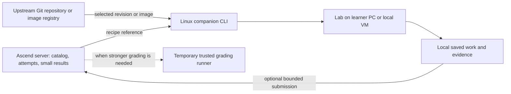

# Linux-first labs: on-demand execution and verification

Proposal dated 2026-11-02, incorporating the owner's explicit **Linux first**
choice. Companion research: [repositories and learning paths](open-source-lab-research.md).
This is the approved implementation plan. Current delivery and runtime evidence
are recorded in [the implementation log](../testing/local-lab-implementation.md).
The shared catalog, file/VAmPI/WrongSecrets pilots and policy submission worker are implemented;
capability-specific work still passes the gates below before becoming executable.

Keep Ascend's server responsible for the catalog, learning state, and small
submissions. Run the selected lab on the learner's Linux PC by default. Fetch a
reviewed source revision, artifact, or image when needed. Store saved work
separately from disposable environments. For assessments that require stronger
evidence, validate answers or rerun a submitted artifact on trusted infrastructure
without hosting the learner's entire interactive session.

## Existing solutions worth borrowing from

| Project | Execution and storage model documented upstream | How work is checked | What to reuse |
| --- | --- | --- | --- |
| [Labtainers](https://github.com/mfthomps/Labtainers) | Linux installation or VM on the student's computer. A lab's first start pulls its required images. `stoplab` preserves work; restarting with `-r` discards the previous lab containers/data. | `checkwork` measures selected lab goals. `stoplab` creates a `.lab` evidence archive; an instructor runs `gradelab` in a grading container. Not every lab has automated assessment, and some checks only count commands. | On-demand lab acquisition, resumable local work, per-lab evidence, separate student feedback and instructor assessment. |
| [StratoCyberLab](https://github.com/stratosphereips/stratocyberlab) | Local Docker range with browser dashboard and WebSSH. Challenges have separate Compose definitions and start on request. | [Development docs](https://github.com/stratosphereips/stratocyberlab/blob/c1093c3a4f1e808a543872a4359f1cd01613644f/docs/development.md) describe flags in `meta.json` checked by the dashboard. Auto-solvers test challenge functionality. | A concrete local Playground experience and recipe layout. A local dashboard is still learner-controlled; locally readable flags are not remote proof of how a solution was obtained. |
| [netlab / BGP Labs](https://netlab.tools/netlab/validate/) | Topology files provision containers or VMs; `netlab down` destroys the lab. Configurations can be collected separately. | `netlab validate` runs tests against the running topology. Exit 0 means all tests passed; 1 means a failure; 2 means no usable tests; 3 means warnings. | Explicit assertions about actual routes/connectivity and meaningful unsupported/error states. Choose an actual lab checkset, not merely a successful command exit from setup. |
| [DevPod](https://github.com/loft-sh/devpod) | A client-only tool for Git/devcontainer workspaces on local Docker, remote machines, Kubernetes, or cloud VMs. | It provisions development environments; it is not a cybersecurity learning grader. | Optional future workspace provider and a portable environment description. A devcontainer's host commands, mounts, and credential forwarding need review before use with vulnerable targets. |
| [Chall-Manager](https://github.com/ctfer-io/chall-manager) | API-driven challenge instances, optional pools, and CTFd integration across infrastructure providers. Its README labels it public beta. | Lifecycle management is separate from answer grading. Infrastructure errors can require operator reconciliation. | Evaluate for a future shared runner, with no warm pool by default. Its generic quickstart explicitly does not provision real target resources until a backend is configured. |
| [Exercism Python test runner](https://github.com/exercism/python-test-runner) | A Docker runner accepts submitted solution files and writes `results.json`; it can be used in local testing of the runner too. | Tests execute against the submitted solution. This provides an implementation example for grading a small artifact independently of a learner's interactive environment. | Local development followed by trusted replay of a bounded submission. Ascend still needs its own exercise-specific tests and execution boundary. |

For Labtainers, the exact inspected [student guide](https://github.com/mfthomps/Labtainers/blob/26c13698619abb4c67fcf483e8720b6c6aa3d6b2/docs/student/labtainer-student.tex)
says that `checkwork` output is not a score or grade. The [instructor guide](https://github.com/mfthomps/Labtainers/blob/master/docs/instructor/labtainer-instructor.tex)
explains artifact collection, `gradelab`, and labs without automated assessment.
Regrading an uploaded archive is useful, but does not make the archive's original
contents tamper-proof on a computer controlled by its author.

## Where each part lives

The initial companion should be a CLI using the existing Ascend application/API
patterns. Start with explicit download/run/check/export commands; an always-on
desktop daemon is unnecessary. An existing upstream launcher can be called by a
reviewed adapter, rather than implementing a second cyber-range framework.

The server cannot read a path on the learner's disk, and the server's `localhost`
is not the learner's `localhost`. Initially, the learner can export a small result
and upload it, or use an authenticated outbound CLI request. A later browser-to-
companion integration needs explicit pairing, loopback-only listeners, origin
checks, and narrow operations. It must not expose a generic shell/Docker API or
open a tunnel into the PC by default. A plain browser download alone cannot
clone repositories, launch Docker, or silently reopen arbitrary local folders.

Windows/WSL2 and macOS are later targets. Record actual tested OS and architecture
per recipe; Linux does not imply both x86-64 and ARM64. The server may still run
on a Pi, while a learner's lab requires a more capable x86-64 workstation.

## Small catalog, explicit recipes

Track and Playground definitions should reference one stable lab/recipe ID.
Keep the following in the catalog, without vendoring complete upstream trees:

- Upstream repository, license/attribution, exact reviewed commit, selected paths
  or artifact URLs and hashes, and image digests for each supported architecture.
- Upstream exercise ID, Ascend prerequisite skills, difficulty provenance,
  learning objective, setup estimate, and separately measured practice duration.
- Execution location and adapter version: local files, local containers, a local
  VM, external hosted service, or learner-owned cloud account.
- Measured download, expanded files, image layers, build cache, peak disk, RAM,
  and CPU requirements, together with the platform and recipe revision measured.
- Readiness probe, reset/stop/export/destroy behavior, saved-work policy,
  resource ownership labels, time limits, and a versioned evidence/check schema.
- What verification is available, where the checker runs, what it proves, and
  whether it can satisfy the particular track's existing evidence requirement.

The [research register](../curriculum/open-source-lab-candidates.json) has
`automatic_execution: false` and empty tested-platform lists deliberately. A
candidate cannot become an executable recipe until its pins, platform support,
license scope, adapter, and lifecycle tests are complete. A GitHub URL alone is
not a runnable recipe, and an upstream branch or `latest` image is not a stable
assessment version.

For source exercises, use a revision-pinned archive or a shallow/partial checkout
where the host supports it. Sparse checkout reduces materialized files but does
not necessarily reduce network transfer; combine it with partial clone or use
individual artifacts. Inspect submodules, Git LFS, and build contexts before
assuming only one directory is sufficient. For data exercises, download the
selected files instead of the entire corpus. A reviewed image may avoid a source
build; measure which option is actually smaller.

Upstream scripts are executable code. Catalog ingestion must not automatically
run a README command, `curl | sh`, arbitrary install hook, or unreviewed Compose
file. Use fixed adapters and reviewed arguments. Reuse Labtainers/StratoCyberLab
in an appropriate local VM when their system-level requirements exceed a small
container recipe. This follows the existing
[isolation design](isolated-lab-research.md), including the separation between
Ascend's application and privileged lab infrastructure.

## Acquisition, saved work, and cleanup

Start should resolve the fixed recipe, check tools/architecture and actual free
space, show the first-download estimate, acquire only missing assets, provision,
and run readiness checks. Start the learning timer when the task is ready. Preserve
Ascend's one-active-session rules across tracks and Playground. A setup failure
is an environment problem, not a failed learning attempt.

Stopping compute does not automatically pause or reset a scored attempt's clock.
Preserve its existing timing rules and distinguish them from saved free-practice
workspace state.

Recommended local layout, respecting the user's XDG directory configuration:

- A cache such as `~/.cache/ascend/labs/sources/` holds replaceable source revisions
  and selected datasets. Docker/VM storage stays in that provider's storage area
  and is accounted for separately; it is not magically covered by this directory.
- A state area such as `~/.local/share/ascend/labs/runs/` records each attempt's
  resource IDs, recipe revision, state, and pending cleanup.
- Saved reports, patches, notes, and explicitly retained projects live under a
  separate work/evidence directory. Cache eviction never deletes them.

| Operation | Runtime | Saved work | Download/image cache |
| --- | --- | --- | --- |
| Stop and resume later | Stop compute or preserve the provider-supported suspended state. | Retain the same attempt and writable state needed for resume. | Retain referenced assets. |
| Finish | Export and validate the requested evidence, then destroy attempt-owned resources. | Retain the chosen report/patch/notes. | Retain only within a configurable cache budget. |
| Reset | Create a fresh attempt/environment according to the recipe. | Preserve prior evidence; discard the selected scratch state only when reset was requested. | Reuse matching immutable assets. |
| Free disk space | Remove inactive, Ascend-owned cached objects that are not needed by a saved/resumable attempt. | Retain user work. | Evict by age/least-recent use within the configured policy. |

Deleting a Git checkout does not delete containers, networks, volumes, image
layers, build cache, VM disks, or cloud resources. [Docker documents](https://docs.docker.com/reference/cli/docker/compose/down/)
that ordinary Compose `down` leaves volumes and images by default and does not
remove external resources. A reviewed adapter should use a unique project per
attempt, inventory its resources, and request removal of its disposable volumes
when appropriate. Preserve explicitly saved volumes/projects. Shared image
layers require reference-aware eviction, and build caches need a dedicated
managed builder or an explicitly scoped policy. Never use a global
`docker system prune` as Ascend's cleanup implementation.

Default to no prefetching of unrelated labs and one active local lab. Make cache
capacity configurable and show the provider's actual remaining disk allowance,
not just the source-repository size or the host root filesystem's free space.
The implemented server submission path limits structured POST bodies to 1 MiB,
including streamed uploads. The policy recipe further limits its one JSON
object file to 64 KiB and 32 rules. The previously proposed 10 MiB general
artifact path is not enabled. Large PCAPs, VM disks, model weights, and complete
repositories stay local or upstream.

Record all created resource IDs before reporting readiness. Make destruction
idempotent and reconcile after process crashes, interrupted downloads, missing
containers, and restarts. Keep `cleanup_failed` visible with remaining resource
IDs and a retry/recovery path. A local watchdog can enforce lifetime while the
PC is running; if the PC is powered off, reconciliation occurs at its next start.
The server cannot promise immediate deletion on an offline PC. For cloud labs,
retain state and resource inventory until provider-side destruction is confirmed.

## What local verification can honestly establish

A learner controls their PC, including checker binaries, flags, environment,
logs, and local signing keys. Local checks are valuable feedback. Their existence
does not prove to a remote server that the expected work happened unchanged.

| Proposed evidence label | Concrete mechanism | Claim supported |
| --- | --- | --- |
| Practice recorded | Learner notes or an explicit completion declaration. | The learner recorded practice. |
| Checked on this PC | Versioned local assertions, HTTP probes, topology checks, or upstream feedback, with structured results. | That local software reported these checks. Appropriate for personal practice; learner-controlled evidence. |
| Answer checked | Server validates a submitted answer/query result against its own known fixture/rubric and the assigned case. | The submitted answer meets that rubric. It does not establish that a particular local tool was used. |
| Submission tested | Upload a bounded patch, configuration, rule, or solution; a trusted isolated runner recreates the pinned exercise and runs its own tests. | The submitted artifact passes the stated tests, including legitimate controls. It does not prove every action in the earlier session. |
| Observed by trusted runner | An administrator-controlled isolated lab/collector checks an assigned instance, or a provider offers a real authenticated verification integration. | The trusted system observed the stated outcome for that attempt. An integration must actually exist and be validated. |

The practical default is local checking for practice, server-checked answers for
small data tasks, and trusted replay for selected repair/configuration tasks.
Reserve full hosted execution for exercises whose important state cannot be
represented by a small replayable submission and for users who need that option.

For example, VAmPI practice can compare access by an owner and another test user
on reviewed vulnerable/fixed configurations. A repair assessment can submit the
patch; a grader applies it to a clean pinned version and checks permitted access,
denied cross-user access, and a changed case. A telemetry task can submit a query,
event IDs, and explanation against a known dataset without uploading a SIEM or
the whole event corpus. A netlab task can export its configuration for replay;
the learner's local exit code alone is still local evidence.

Bind submissions to an account, attempt, lab version, fixture/seed, and checker
version. Use server-issued attempt tokens/nonces for online assessments and reject
cross-account use and replay. Offline practice can be saved and synchronized
later with its true evidence label. Nonces limit replay; they do not make a local
checker tamper-proof or establish trustworthy offline timing.

The server must determine the required test set and allowed evidence shape. It
must not trust client-supplied `passed: true`, an empty test list, a claimed
checker version, or a shell exit code without the corresponding contract. Preserve
separate `pass`, `fail`, `error`, and `unsupported` outcomes. Test the checker's
ability to reject broken/incomplete work, not just accept the happy path.

Do not copy Ascend's administrator HMAC signing key onto learner PCs. A separate
per-device login token identifies a submitter, not the integrity of their machine.
The existing [signed proof collector](../../scripts/collect_lab_proof.py) can
remain a trusted-runner path when its key and observations stay under the
administrator's control. Local-only receipts must not silently satisfy existing
verified track milestones or replace prior assessment receipts.

Treat uploaded archives and submitted code as untrusted. Prefer explicit small
JSON/patch/configuration schemas, enforce bounds and ownership, reject traversal
and special-file extraction, and run executable submissions only on the separate
isolated grader. A server-side rerun is additional short-lived compute, even
though it avoids hosting the full interactive lab. This is the cost/assurance
tradeoff to expose per assessment.

## Implementation sequence and acceptance

| Stage | Concrete deliverable | Exit condition |
| --- | --- | --- |
| 1. Reference catalog | Candidate-to-recipe review flow, source/version/requirements display, and external/local execution labels shared by tracks and Playground. | No candidate appears runnable without a reviewed adapter and measured platform support. Existing generated practice remains usable without installing tools. |
| 2. First Linux file pilot | One reviewed Security Datasets evidence slice plus benign control, fetched on demand; local work/export and a small server-side answer rubric. | Measure download/peak disk; verify an incorrect answer and missing evidence cannot pass; demonstrate save, offline return, and cache cleanup without loss of work. |
| 3. First Linux service pilot | VAmPI pinned to the reviewed source, a vetted container build/image, owner/non-owner checks, and explicit ready/stop/reset/export/destroy operations. | Pass tests on known good/bad configurations and legitimate traffic. Repeated starts, interrupted provisioning, expired runs, and cleanup failures leave correct state and no untracked resources. |
| 4. Adopt established local labs | Labtainers `network-basics` and `telnetlab`; then selected RESTaurant and BGP Labs tasks. Adapt upstream lifecycle/checkers individually. | Document each upstream check's meaning and limitations; validate evidence collection and Linux support. Keep local feedback distinct from trusted replay or instructor review. |
| 5. Stronger grading where useful | Temporary grader for one submitted API patch or network/configuration task; server-owned tests and bounded work uploads. | Reject fabricated receipts, cross-user submissions, wrong revisions, replay, malicious paths, and incomplete test sets; preserve existing track/reward semantics. |
| 6. Specialist and shared-runner expansion | WrongSecrets local subset, then selected cluster/VM/cloud/mobile/LLM recipes; evaluate Chall-Manager for server-side needs. | Each capability class has its own measured requirements and lifecycle/isolation evidence. No automatic claim of Pi/ARM support or free cloud usage. |

For each runtime pilot, record cold/warm startup time, download and expanded
sizes, peak/residual disk, RAM, CPU/PIDs, and the tested OS/architecture. Exercise
the normal lifecycle, a killed runner, missing containers, disk-full conditions,
and a failed evidence save. Verify resource counts and saved work after repeated
cycles. An upstream maintenance report or a mocked runner test is not a substitute
for this deployed-environment evidence.

The source research and Linux-first decision are complete. Consult the
implementation log for the status and actual validation of each stage; a
reference or an adapter contract is not a claim that an upstream environment has
been validated.
