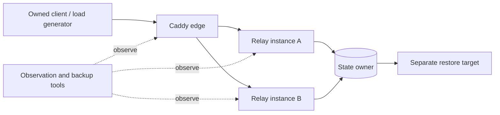
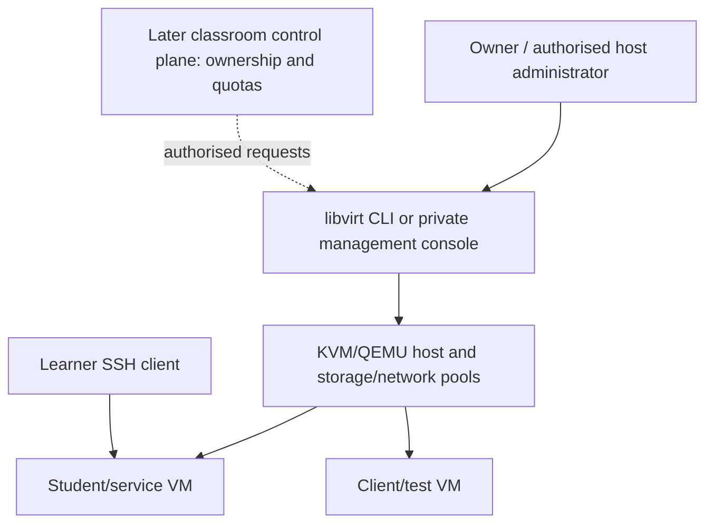

# Local to Internet: capacity, resource control, and hardware labs

**Design and source review, 2026-11-03.** This is the capacity and device companion to the proposed Infrastructure & Internet Operations domain and the [DevOps curriculum](devops-track-design.md). It covers concurrency, load balancing, sizing, storage, recovery, and how the same learning outcomes progress from one PC to small physical servers and larger infrastructure.

The operating principles below are supported by the linked primary documentation. The lab cards, hardware envelopes, timing, and acceptance rubrics are **proposed curriculum**, not results of a hardware benchmark or a completed learner trial. No host tuning, storage stress, cloud provisioning, or privileged networking was performed for this document. The [source ledger](local-to-internet-capacity-sources.json) records retrieval dates, hashes, and access limitations.

## The system learners build

Use the track's evolving Relay application. Give it a version endpoint, liveness and readiness endpoints, a small read/write workflow, structured request IDs, bounded work admission, and observable active/queued/rejected counts. A learner should be able to identify which process owns a request and which component owns durable state.



Begin with one process and SQLite. The first two-replica exercise uses stateless/read-only responses. Add shared writable state later through an explicitly designed PostgreSQL exercise. Running two independent writable SQLite copies does not produce one consistent service; putting SQLite WAL on a network filesystem does not provide a supported shared database. WAL permits readers alongside a writer, but retains a single-writer limit. [SQ1]

The same diagram can run as several processes, containers, or VMs on one PC. That proves selected routing, application, and recovery behaviour. All its components still share a physical machine, storage subsystem, and power source. Distinct processes or containers are not evidence of host high availability.

## Tool choices and the mechanism each teaches

| Function | Initial choice | Why this belongs in the core | Later translation |
| --- | --- | --- | --- |
| Edge and load balancing | **Caddy** | A small readable configuration supports explicit balancing policy, active readiness checks, passive failure handling, and observable routing. This choice aligns with the accompanying local Caddy proof. | Translate the same controls to NGINX; then HAProxy where deeper connection/queue policy is useful. Configuration and feature availability differ. |
| Load generation | **k6 CLI on the learner PC** | Separate user concurrency from offered arrival rate; record failures, latency, completed work, and dropped iterations. | A smaller HTTP generator is sufficient for basic checks; scripted browser load is a different, more expensive experiment. |
| Process/resource control | Linux systemd units and **cgroup v2** | Show why relative scheduling weight, a hard CPU quota, reclaim pressure, and an OOM boundary produce different outcomes. | Container flags and Kubernetes requests/limits are translations of resource policy, not substitutes for understanding it. |
| State | **SQLite**, then PostgreSQL | Make file ownership, locking, write durability, pool limits, and recovery concrete before database replication. | Introduce a cache or broker only when an experiment demonstrates the need. |
| Observation | `curl`, process/socket tools, application counters, cgroup counters, `vmstat`/`iostat` when available | Identify request latency, resource pressure, and queue growth without first installing a large monitoring stack. | Prometheus and a small dashboard on the PC; add distributed tracing when a multi-service question requires it. |
| Recovery | Application-consistent backup plus a restore into a separate target | A backup file is useful only when its required data can be restored and checked. | An external drive/NAS/offsite target, database-native continuous backup, and separately measured failover. |

Caddy defaults to a random load-balancing policy. Set `round_robin` or the chosen policy explicitly when the exercise depends on predictable distribution. Active checks require a configured health endpoint; passive checks require configuration such as a nonzero failure window. A running process can fail readiness, and a cached green liveness response cannot establish that a write or dependency works. [LB1]

NGINX's upstream documentation distinguishes directives and edition/version constraints. Do not copy an NGINX Plus-only queue, health-check, or state-management feature into a promised free NGINX lab. The translation rubric checks equivalent externally observed behaviour rather than matching directive names. [LB2]

The core tools are available as free software; electricity, hardware, storage wear, connectivity, and optional third-party hosting remain separate costs. A cloud-branded dashboard is not a prerequisite for using the local k6 CLI or Prometheus.

## Fundamentals that must precede sizing

**Concurrency** is work in progress. **Parallelism** is work executing simultaneously. A waiting network request can consume an open connection and memory without continuously occupying a CPU core. HTTP/2 can carry multiple requests on one connection. An application worker limit, database-pool limit, reverse-proxy connection count, and request admission limit therefore measure different boundaries.

Trace the complete path: client arrival → accepted connection/request → admitted application work → waiting for a worker or database → useful execution → response. Distinguish requests offered by the client, requests admitted, requests completed successfully, deliberate overload rejections, timeouts, and unfinished work. An improving average latency caused by rejecting most traffic is not increased useful capacity.

Record the four service signals—latency, traffic, errors, and saturation—and examine resource utilisation, saturation, and errors. A low host-average CPU percentage can conceal one saturated core, CPU quota throttling, a locked writer, or time waiting for storage. [SR2], [USE1]

Teach the following small calculations with measured inputs:

- **Little's Law:** `mean work in progress = admitted/completed throughput × mean time in the same boundary`, for a stable observed system with consistent accounting. For example, 40 completed requests/second and a mean 0.15-second time in that system imply approximately six requests present on average. That does not prescribe six threads or six cores. A growing, overloaded queue is not a steady-state capacity estimate; a p95 latency cannot replace the mean in this relation.
- **CPU budget:** estimate measured CPU-seconds of useful work per request × useful requests/second, then add measured background/retry/checking work and choose headroom. Do not substitute wall-clock latency for CPU service time. A CPU quota experiment is not a benchmark of a physically slower CPU.
- **Memory budget:** account for base process state, measured worker/pool overhead, bounded peak active requests, bounded queued payloads, database/cache use, and transient work. Use a peak concurrency bound, not Little's Law's mean. Summing process RSS can double-count shared memory; cgroup accounting and a stated measurement boundary help.
- **Network budget:** useful payload bytes × rate plus protocol, encryption, retries, and concurrent transfers. Test upstream bandwidth, path latency/loss, connection establishment, and reachability separately. A fast LAN result cannot establish home-Internet upload capacity.
- **Storage budget:** durable dataset + WAL/journal/checkpoint activity + retained logs/metrics + images/build cache + backups/staging + compaction and free-space reserve. Filesystem free bytes, inodes, and write latency matter independently of nominal card size.

PostgreSQL's `work_mem` can apply to multiple operations and sessions, with additional effects from parallel work. It is not one global reservation. Teach pool bounds and concurrent query shape before increasing memory knobs. [PG1]

## Proposed resource profiles

These are starting **admission envelopes**, subject to the preflight and measured peak of each concrete recipe. They are not vendor minimums, benchmark results, or a promise that any software combination fits. RAM quantities below use GiB; storage manufacturers' 100–120 GB is roughly 93–112 GiB before formatting and other uses. Inspect actual available space.

| Profile | Suggested initial envelope | Work it supports | Work placement decision |
| --- | --- | --- | --- |
| Always-on server: about 4 cores, 4 GiB RAM, microSD | Start with deployment processes capped around **1 GiB total** and a **256 MiB** short check allowance. Plan approximately **1.75 GiB** for the OS, existing services and cache, plus **1 GiB** spare. Recalculate if the machine already hosts Ascend or other services. | One small service, a proxy, SSH/tunnel agent, and compact observations; selected experiments run sequentially. | Build images, generate load, analyse results, and retain metrics on the PC. Do not assume a second full stack fits. |
| Same server with 8 GiB RAM | Initially allow around **2 GiB** for the service exercise and **512 MiB** for tools, retain at least **2 GiB** for existing services/cache and **2 GiB** uncommitted; leave the remainder unallocated until measured. | Small read-only replicas or a bounded database case when observed memory fits. | Memory growth does not remove the microSD, USB, cooling, power, or uplink constraints. |
| Learner PC: about 16 cores, 16 GiB RAM, at least 200 GB free SSD | Start with a Linux lab VM/all lab workloads capped at **8 GiB**, retain about **6 GiB** for host OS/browser/editor, and **2 GiB** for transient headroom. Begin with roughly **4 vCPUs** for services; allocate generator CPU separately where practical. Plan a **60–80 GiB** exercise footprint, with a clear image/VM cleanup ledger. | Several light instances, bounded PostgreSQL, an observation stack, a small virtual network, and later a small cluster used sequentially. | A 16-core count does not make 16 GiB unlimited. Measure the workload, generator, hypervisor, and host separately; lower the lab budget when normal desktop work needs more. |
| Larger PC, external SSD, second machine, or larger VPS | Expand only the resource responsible for the demonstrated limit, then remeasure. | More representative concurrency, stateful branches, multi-host recovery, separated generator/observer, longer retained evidence. | Preserve skill progress and replay the same experiment with a changed topology; a larger host does not require restarting the course. |

For the small target, begin with at least the larger of **10 GiB or 20% of its usable filesystem** free as a proposed operating reserve. This is a course policy to validate, not a general filesystem rule. Preserve the existing Ascend runner's 10 GiB minimum and its full reservation/cleanup accounting wherever the stricter policy applies. A budget alarm should stop new experiments before an administrator has to rescue a full root filesystem.

The shared Ascend runner remains capped at **two hosted labs overall**. Full learner-generated builds, VM/cluster administration, load generation, disk-pressure experiments, mail stacks, and arbitrary network configuration belong on learner-owned disposable environments. This document does not increase hosted capacity or declare the existing runner safe for arbitrary shell execution.

### Software and operating-system fit

Use a tested Linux userspace and record CPU architecture, kernel, cgroup availability, tool versions, memory limits, free space, and network mode in a short preflight manifest. A physical Pi, a Linux VM, a WSL2 distribution, and a macOS container VM are different environments.

Windows WSL2 has its own memory/processor/swap controls; Microsoft's documented defaults currently give it 50% of host memory and the host's logical processor count. Explain the selected VM budget rather than assuming every learner receives the entire PC. WSL1 is not a substitute for the Linux-kernel resource-control labs. Test reachability from the Windows host and from another LAN device separately. [WS1]

On macOS, use a Linux VM for Linux administration/cgroup labs and record the VM's actual allocation. On ARM, verify native packages/images for each selected tool. Cross-platform emulation is a fallback that can be significantly slower for compilation and compression; it must not be silently used to claim native performance. [MP1]

## Core VM host administration

This is a prerequisite sequence within the wider Infrastructure & Internet Operations domain. A guest does not need an open VMware/VirtualBox-style desktop window to keep running. A host-managed hypervisor process and management service can run it continuously; the owner connects through a CLI/web console, and learners connect separately to guest SSH. Closing the browser or management window should leave the guest's lifecycle unchanged.

Use **KVM/QEMU with libvirt on an existing compatible Linux host** as the first host-administration path. `virsh` is the CLI; virt-manager is an optional desktop management interface; Cockpit Machines supplies a web interface using libvirt and associated VM creation tools. They operate the host's VMs rather than replacing the guest OS. The course must test the selected distribution/packages, CPU virtualisation support, firmware setting, kernel and permissions before advertising a supported host recipe. [VM1], [VM2], [CK1]

**Proxmox VE** is an alternative dedicated host platform with a web console, CLI/API, storage/network administration, permissions and backup tooling. It should have its own install/operation recipe. An installer that repartitions disks changes the selected machine; the beginner route uses an existing Linux host, a spare machine/disk, or a clearly labelled nested VM demonstration when the outer platform actually exposes acceleration. Proxmox's host memory, storage, CPU/architecture requirements and guest allocations are cumulative; a product's management-plane minimum is not the total needed by this course's VMs. Its documentation lists additional requirements for storage systems such as ZFS/Ceph. [PV1]

On Windows/macOS, first use a tested compatible local hypervisor recipe for ordinary guest creation. Nested KVM/Proxmox is a separate conditional branch: CPU architecture, outer hypervisor, virtualisation extensions, guest firmware and resource cost must all fit. Full emulation can demonstrate some interfaces but cannot provide native-performance evidence. A Pi's ability to run ARM Linux does not by itself establish compatibility with every hypervisor appliance or x86 guest image.

### Host, guest, and control-plane authority



The college-style SSH account lives inside its assigned guest. It does not automatically grant access to the hypervisor, host files, another guest, or the right to resize a machine. A personal lab owner may hold both roles. For a classroom, a separately authenticated control plane maps users to VMs and constrains start/stop/resize requests with ownership, quotas, host capacity, task status and audit events. Giving students access to the unrestricted libvirt socket is not that control plane. Keep the management interface on an intentional private/admin path; guest service publishing is a separate network policy.

A hypervisor supplies virtual CPU, memory and devices. A host manager supplies lifecycle/storage/network operations. A private-cloud control plane adds pooled capacity, tenant identity, orchestration and governance. Building that later control plane is a further domain track; learners can learn these mechanisms and use existing host managers first.

### First two guests and resource changes

For the 16 GiB PC profile, begin with a **service guest around 2 GiB RAM / 2 vCPUs / 16 GiB virtual disk** and a **client guest around 1 GiB RAM / 1 vCPU / 8 GiB virtual disk**. These are plain-Linux-image planning envelopes, not measured minimums or space reservations. Include QEMU/host tooling and the observer in the overall 8 GiB lab budget. A thin virtual disk's maximum capacity, currently allocated bytes, snapshot/backing files and free host storage are different quantities.

Start with read-only inventory on the selected host connection; the lesson's prepared guest is named `relay-vm`:

```bash
virsh --connect qemu:///system list --all
virsh --connect qemu:///system dominfo relay-vm
virsh --connect qemu:///system vcpucount relay-vm
virsh --connect qemu:///system dommemstat relay-vm
virsh --connect qemu:///system domblklist relay-vm
```

The learner compares host-reported state with `nproc`, memory and block/filesystem observations inside the guest. Missing guest-agent/balloon statistics must be explained, not silently treated as zero usage. The system libvirt connection is an administrative boundary; a user-session connection can have different networking/ownership behaviours.

| Host operation | Mechanism to teach | Practical acceptance |
| --- | --- | --- |
| Start, graceful shutdown, force off, autostart | Persistent VM definition versus a running process; guest shutdown signalling; force-off versus removing the definition or its disks. | Close the management UI and retain SSH/service reachability. Reboot the disposable host in the authorised exercise and verify the declared autostart/dependency behaviour. A clean guest shutdown and a forced power loss produce separately recorded results. |
| Change vCPU count | Configured next-boot count, current hypervisor count, hotpluggable maximum, and guest online CPUs. `setvcpus` has live/config/guest distinctions and support limits. | Change a count within the validated recipe, read back host and guest state, and state whether it took effect immediately or after shutdown/restart. A vCPU is scheduled work, not a guaranteed dedicated physical core. |
| Change memory | Initial/maximum memory, balloon target/reclaim, guest driver cooperation, optional supported memory hotplug, and next-boot changes. `setmem --live` balloons where supported; it does not manufacture host RAM. | Use a small bounded fixture, verify actual guest-visible and host-resident memory, keep the declared host reserve, and recover a failed/unsupported request without a false success message. Memory reduction and memory-device removal need their own constraints. |
| Increase disk capacity | Host storage pool, image/volume capacity, guest block-device rescan, partition or LVM growth, then filesystem growth. | Retain known data, verify capacity at each layer, and recover from a deliberately incomplete resize that leaves the guest filesystem unchanged. Start with expansion; shrinking has additional filesystem/layout constraints and is a separate advanced procedure. |
| Clone from a template | Immutable image provenance plus per-instance seed/configuration, instance ID, hostname, network identity and SSH access. | Create two independently identifiable guests. Verify authorised keys and fresh host identities. No private keys, passwords, service tokens or old machine identity are embedded in a public/shared template. |
| Restore after loss | VM/application consistency, backing-file relationships, independent exported backup, a new target and application-level validation. | Restore the required VM/configuration and data, then test the service. A snapshot that depends on the same lost storage cannot satisfy the independent recovery objective. |

These distinctions follow libvirt's live/persistent and resource-device models; an unsupported live change can require a planned shutdown and must be shown that way. The reference lab should begin with reliable powered-off resizing, then add hotplug/ballooning only for a tested guest/driver/hypervisor combination. Avoid teaching a universal command that supposedly hot-adds or hot-removes arbitrary memory and CPUs. [VM1], [VM2]

Use cloud-init's NoCloud seed mechanism as a practical bridge from downloaded cloud images to learner-owned VMs. Teach `user-data`, `meta-data`, instance identity and first-boot application. A cloud-init file is not evidence that it ran successfully: inspect completion/logs and the resulting user/network/service state. Use public-key access in the authored lesson even when an upstream demonstration uses a password. [CI1]

### Virtual networking and the eight core cards

Start with a private virtual network and known DHCP/DNS/addresses. A typical NAT mode allows guest-initiated outbound access but needs a deliberate path for clients outside that network to initiate connections. Bridging can place a guest directly on an external layer-2 network when the NIC, upstream network and policy support it; Wi-Fi often needs a different recipe. Routed networking requires an upstream return route or another explicit mechanism. None of those labels alone makes the guest publicly reachable. Keep host/guest firewall, guest bind address, subnet, route and DNS tests separate. [VM3]

| Card | Work to perform | Finish line |
| --- | --- | --- |
| **V0. Verify the host** | Inventory architecture, virtualisation support, free resources, storage pool, admin permissions and a recovery route. Select one tested host recipe. | Explain which layer will run the guest and what resources remain for the host. Unsupported nesting is identified before installation. |
| **V1. Create a guest** | Obtain the reviewed image, create storage and a VM definition, add per-instance configuration, boot and inspect its console/state. | A reproducible guest boots with the intended OS/version and owned storage/network resources. |
| **V2. Use SSH and distinguish roles** | Connect to guest SSH, verify host identity, run the service, close the host-management UI. | The service/SSH session remains available as expected; the guest user has no unintended authority over another VM or the hypervisor. |
| **V3. Operate lifecycle** | Start/shutdown/autostart a guest, distinguish force-off/undefine/delete-storage, recover a supplied boot/service fault. | The declared host/guest restart policy and recovery instructions work with retained application data. |
| **V4. Resize CPU and RAM** | Make a bounded powered-off change; then test one supported live mechanism. Read back host and guest state. | A requested change is either confirmed at every relevant layer or rejected with a useful recovery path. Host reserves remain intact. |
| **V5. Expand storage** | Grow an owned virtual disk and complete its guest partition/LVM/filesystem steps. | The guest can use the new space; the known data remains correct; snapshots/thin allocation are still accounted for. |
| **V6. Change reachability** | Reproduce two virtual network modes and test host, peer guest, LAN and outbound paths independently. | The intended client can reach the intended service, and a disallowed path remains blocked. No claim of Internet publication from a host-only test. |
| **V7. Recreate and restore** | Clone a clean template with new identity, retain a consistent backup, remove the disposable original, and restore into an independent target. | The restored service/data meets its rubric, the two guests are distinguishable, and the cleanup inventory contains no unowned deletions. |

In a later classroom/control-plane track, extend V4 with per-user and per-host quotas, reservations, actual allocation state, an operation queue and audit records. Test a denied resize and concurrent requests as well as success. CPU overcommit is an explicit scheduling choice; memory overcommit is not free capacity, and ballooning does not guarantee timely reclaim. The same host must retain room for its management services and storage/cache work.

## Practical lab cards

Each card needs an authored fixture, a worked demonstration, a fresh independent fault or changed condition, a reference solution, negative controls, resource/cleanup instructions, and a saved evidence bundle. Tool installation alone cannot complete the card. The accompanying loopback proof establishes only its recorded routing/concurrency controls; the complete cards below still require implementation and review.

| Card | Learner actions and experiment | Required result and negative control | Execution location |
| --- | --- | --- | --- |
| **C0. Predict before deploying** | Inventory the machine; draw request/state paths; allocate service, observer, data and transient budgets; record versions and architecture. Deploy one small service and compare actual steady/peak use with the estimate. | Explain the largest error in the estimate and revise the budget. A config file stating `memory: 256M` without an enforced/read-back limit does not count. | PC first; repeat on small server. |
| **C1. Make work visible** | Give requests IDs; measure admitted, active, queued, completed, rejected and timed-out work. Run an I/O-waiting variant and a CPU-work variant with the same small request batch. | Explain why equal concurrency can give different CPU usage. Counters reconcile within the stated time window and include unfinished requests. | Processes or one Linux VM. |
| **C2. Compare load models** | Run a capped closed-user test, then an arrival-rate test against the same fixture. Introduce bounded service delay. Record requested arrivals, completed useful responses, errors, p50/p95/p99, and generator health. | Show whether offered traffic fell when latency rose. Explain k6 `dropped_iterations`; a test that cannot deliver its configured arrival rate cannot prove that rate is sustainable. | PC; use low bounded rates first. |
| **C3. Bound concurrency and backpressure** | Set a small active-work limit and a finite queue with an expiry. Send a slightly larger bounded batch. Return a clear overload response for work that cannot be served, preserve request identity, and stop retries after an explicit budget. | At most the configured work is active; queued work is bounded; accepted writes do not duplicate on retry; a healthy probe remains usable. An unbounded thread or queue count fails the exercise. | PC process fixture, then disposable Linux resource group. |
| **C4. Balance, fail, and drain** | Add two stateless instances with distinct version/instance IDs. Configure Caddy policy explicitly. Make A unready while an accepted long request is in flight; stop directing new work to A, wait for accepted work or a deadline, then remove it. Restore it deliberately. | Record distribution, detection delay, failed requests, in-flight completion/deadline, and recovery. With one healthy instance remaining, state the reduced capacity. A 200 liveness response from a broken dependency must fail the readiness control. | One PC topology; repeat across two physical hosts later. |
| **C5. Keep state correct under replicas** | First demonstrate why per-instance session/data state breaks when requests change instance. Use stateless requests or move the required state into an explicit shared store. Exercise pool saturation and one duplicate write retry. | The result remains correct through an instance change and the retried operation has one intended effect. Sticky sessions alone do not make state durable or failover-safe. | PC; PostgreSQL variant follows SQLite basics. |
| **C6. Observe resource enforcement** | In a disposable Linux VM, read cgroup limits and counters. Compare two competing groups' CPU weights with a hard quota; approach a bounded memory high/max limit using a capped fixture. Observe reclaim, throttling or a controlled process kill and recover it. | Attribute the failure to the observed controller and show unaffected ownership boundaries. Do not kill host processes or infer that a nonzero CPU share reserves dedicated cores. | Learner-owned disposable Linux VM; never shared Ascend. |
| **C7. Operate writable storage deliberately** | Count/log writes, bound logs and scratch space, observe SQLite WAL growth under a bounded long reader, release the reader and checkpoint. Create a bounded insufficient-space fixture and check the application's failure/cleanup behaviour. | Explain remaining bytes/inodes, retained evidence, and recoverability. A copied live `.db` without a valid consistency procedure does not pass backup validation; do not fill a real root filesystem or benchmark a raw block device. | PC sandbox; repeat the normal workload on microSD. |
| **C8. Restore and measure loss** | Record a known sequence of committed items and a backup time. Restore into a separate empty target; measure last recovered item, time to serve verified requests, and missing acknowledged changes. | State the observed recovery-point loss and restoration time with their time boundary. An existing backup, a VM snapshot alone, or a dashboard green light is insufficient. | PC; backup target can later be a separate device. |
| **C9. Estimate, optimise, and explain** | Choose one measured bottleneck; change one control such as query shape, cache bound, batching, pool/worker bound, payload size, retention, or storage placement. Repeat the same workload and correctness checks. | Show comparable before/after resource and tail-latency results, include rejected work, and identify the new limiting component. Disabling required durability to get a faster chart does not satisfy the original task. | PC and small-server profiles. |
| **C10. Change the failure domain** | Move an instance, generator, observer, or restore target to another machine. Reuse the original deployment manifest/runbook, then perform one authorised service or network disconnection and recovery. | Identify which original shared failures remain: edge, database, router, WAN, power, or backup location. A virtual node label cannot satisfy a physical power-domain result. | Two owned devices; virtual equivalent earns the software-topology outcome. |

The k6 documentation explicitly distinguishes closed iterations, which wait for earlier work, from arrival-rate executors. Closed tests are useful for a chosen user population; they can hide the offered-load consequences of slowing service when the intended question is sustained arrivals. Dropped iterations can reflect generator configuration or a system whose longer response time exhausts available VUs. Both must be investigated. [K61], [K62]

For initial authoring, use short runs, a declared maximum arrival rate, a bounded number of clients, a fixed timeout, and a known small response size. The actual exercise manifest must name the learner-owned destination, total duration/request budget and stop conditions. Do not send load through a third-party free tunnel or public service to avoid local limits. Warm-up, repetitions and a separate generator are introduced before making capacity claims. The course must not publish a visitors-per-second promise from one happy-path run.

Overload handling includes admission, controlled degradation where the task permits it, and bounded retries. A failing dependency can be overloaded further when several layers independently retry. The reference solution should show where retries belong and which operations are safe to retry. [SR1]

The cgroup lab must teach the actual controller semantics: `cpu.weight` influences relative allocation under contention; `cpu.max` limits CPU bandwidth. `memory.high` induces reclaim/throttling, while `memory.max` is a harder boundary with possible OOM action. Capture the relevant `cpu.stat`, memory usage/events, and pressure signals. A process restart must be investigated rather than silently counted as successful recovery. [CG1]

## The small-server specialisation

Treat the microSD board as a useful deployment target, while placing compilation, image builds, high-rate load generation, large dashboards, and long-term metrics on the PC. This teaches placement and measurement using the resources available today.

1. **Account for writes.** Separate application records, database WAL/checkpoints, web/access logs, journal, metrics WAL, container overlay writes, package/build caches, swap, and backups. A card's advertised sequential speed or application class does not establish its endurance or power-loss behaviour. Measure the actual card/workload; use its manufacturer's specification when discussing lifetime. Raspberry Pi's documentation explicitly notes that storage behaviour can constrain a more capable CPU. [RPS]
2. **Keep bounded useful logs.** Retain sufficient incident evidence, use rotation/limits, and send selected observations to the PC. systemd-journald provides both a maximum-use budget and a keep-free budget. Volatile logs save persistent writes but consume RAM and can disappear on reboot; make that tradeoff visible. Do not globally disable logs as an optimisation exercise. [JR1]
3. **Limit metric cardinality and retention.** Start with direct counters or scrape from the PC. If Prometheus is local, budget memory, WAL/head data, persistent blocks and compaction; set explicit short retention and size limits. Prometheus recommends keeping a buffer for compaction, and its small compressed bytes-per-sample estimate is not the whole runtime footprint. [PM1]
4. **Make database changes correctly.** Shorten unnecessary transactions, use bounded batching only where semantics permit, and observe checkpoint behaviour. A long SQLite reader can hold back checkpoint progress. Turning off required durable writes changes the guarantee and cannot be a hidden optimisation. [SQ1]
5. **Plan maintenance.** Test owned-resource cleanup, a bounded update/rollback, an application-consistent backup, and a restore. Schedule larger work to avoid saturating the same storage as the serving application. Preserve a usable control path when the application becomes slow.
6. **Upgrade the evidenced bottleneck.** Moving writable service data to a compatible powered USB SSD can improve the storage profile; adding RAM cannot fix every I/O or power problem. Retain the old known-good boot/recovery path until the migration and restore are verified. Never estimate a card's remaining lifetime from a short benchmark alone.

A board that runs continuously is still subject to power interruptions, clock/thermal behaviour, router/ISP interruptions, full filesystems, certificate/credential expiry, and an operator making a bad release. Continuous operation is a process and a recovery plan, not simply leaving the power cable connected.

## Devices: what they add and how to practise without them

No hardware purchase is a prerequisite for the core software/network learning. Start with the existing PC, then repeat selected outcomes on available hardware. A learner's curriculum record should show **the outcome and environment actually demonstrated**, so adding a Pi, disk, router, or second host becomes a continuation.

| Device or setup | Useful exercises and advantage | PC-only equivalent | Boundary to state before starting |
| --- | --- | --- | --- |
| Existing Linux PC, several processes | First request path, concurrency, Caddy routing, state and short load experiments with very little setup. | This is the lowest-dependency route. | Shared kernel/resources; processes are not separate hosts. |
| Linux VM(s) on the existing PC | Separate OS configuration, SSH, virtual interfaces/routes, firewall, service manager, controlled resource failures and resettable state. | Two or three small VMs or fewer sequential roles, within the measured RAM budget. | Virtual machines share the laptop's power, storage and often uplink. Container networks alone do not reproduce every kernel/admin outcome. |
| **Raspberry Pi 4, with a suitable RAM variant** | Headless ARM Linux, an inexpensive-to-run separate target, Ethernet, real reboot/boot media, USB storage and constrained operation. | ARM/native package checks where supported; otherwise a Linux VM reproduces service outcomes. | Confirm installed RAM, architecture, boot firmware, storage/power and cooling. Pi 4 supports Gigabit Ethernet and USB 3; its documented supply recommendation is 5 V/3 A class. [RP4], [RPP] |
| **Raspberry Pi 5, with a suitable RAM variant** | Repeat the same service on a newer ARM platform, compare sustained behaviour, use USB storage or a supported PCIe/M.2 storage path. | Same deployment and limits in a VM; cross-architecture build evidence can be added separately. | Pi 5's documented supply is 5 V/5 A class, with a compatible connector/cable. A lower USB power allowance can affect drives. Cooling, adapters and installed RAM are part of the complete system. [RP5], [RPP], [RPF] |
| **Pi Zero / Zero W / Zero 2 W class** | A lightweight client, small edge/service, SSH practice, periodic probe or dedicated observer. Demonstrates working with a much tighter memory/network budget. | A capped single Linux service or small VM teaches many allocation decisions. | These documented boards have 512 MB RAM. Original Zero variants use a single-core 32-bit CPU; Zero 2 W uses a quad-core 64-bit CPU. The family has a single micro-USB data port; do not assign the full container/monitoring/database stack to it or assume every modern binary supports it. [RPZ], [RPP] |
| Old laptop or mini PC | Reuse existing x86/ARM hardware for an always-on target; often easier RAM/storage expansion. A second physical box creates a separate host failure domain. | Several VMs reproduce selected software behaviour. | Measure idle/sustained power, cooling, disk health, sleep/lid policies, boot recovery and NIC. A laptop battery's presence alone does not establish unattended shutdown/UPS behaviour. |
| Spare router supported by **OpenWrt** | Observe the real gateway, DHCP/DNS, routes, NAT, firewall, VLAN/trunk and VPN placement using a dedicated lab network. | A Linux router VM and virtual client/server networks teach routing/firewall outcomes. | Check exact model/revision, supported release, flash/RAM, recovery method and image before selecting it. Use a spare; disrupting the household's only router is not a prerequisite. [OW1] |
| Managed Ethernet switch | Real access/trunk ports, VLAN isolation, link events and counters; distinguish layer-2 isolation from routed policy. | A VLAN-aware virtual switch/bridge topology with the same tests. | VLAN support and management recovery are model-specific. Extra ports do not increase Internet upload bandwidth. |
| USB Ethernet adapter | A second physical interface for a lab router/client, controlled WAN/LAN separation and cable-level faults. | Two VM virtual NICs. | Check driver/architecture, bus/link negotiation and available power. Do not bridge two interfaces blindly and create a loop. |
| USB SSD / supported NVMe adapter | Move persistent workload from microSD, compare latency and write pressure, migrate and restore a service, separate boot from data. | A second virtual disk reproduces mount/ownership/full-disk/restore procedures. | Boot mode, firmware, bridge/adapter, power and bus limit are device-specific. Pi 4/5 USB boot support does not guarantee every enclosure works. [RPU], [RP5] |
| UPS or explicitly supported battery system | Observe supply loss, runtime budget, battery telemetry, graceful shutdown, boot recovery and the router/modem's power dependency. | A VM shutdown/restart reproduces software recovery only. | A power bank's capacity or pass-through claim does not prove uninterrupted switchover, correct USB-PD output, telemetry or shutdown support. Use the exact device documentation and a controlled test; do not improvise mains wiring. |
| External backup disk or NAS | Restore onto different storage, check ownership/retention, recover after loss of the serving device. | A separate directory/virtual disk proves limited restore logic. | A second copy on the same disk or same failed power domain is not equivalent. A NAS/RAID setup alone does not establish an independent/offsite backup or tested recovery. |

The official Pi product briefs and documentation establish supported interfaces and documented supply/thermal behaviour, not an Ascend capacity rating. Manufacturer historical current measurements use a stated setup and must not be repackaged as this course's measured watts. [RP4], [RP5], [RPP]

For the physical-device extension, save a short hardware record: exact model, RAM, OS/architecture, storage model/interface, power supply/cable, active peripherals, network path and cooling. Observe idle and sustained service behaviour under the same **bounded** workload, including temperature/frequency/power warnings where exposed. Raspberry Pi documents thermal throttling and model-specific frequency behaviour; use it to explain a changing throughput curve, without disabling the board's protections. [RPF]

## Progression without a resource ceiling

| When resources change | Repeat this existing experiment | New outcome to demonstrate |
| --- | --- | --- |
| Add an external SSD | C7/C8/C9 using the same workload and state checks. | Explain the measured storage change, migrate safely, and prove restore after migration. |
| Add RAM | C5/C6/C9 with controlled cache/pool limits. | Show whether memory was actually limiting; avoid converting spare RAM into unbounded work. |
| Add another machine | C4/C10 and a separated load generator. | Measure behaviour when one actual host goes away and identify remaining single points. |
| Obtain a routable VPS or second network | Reuse deployment/access modules and C4/C8/C10. | Account for WAN latency, uplink, security/identity, outage and billable resource boundaries. |
| Adopt a cluster | Re-express C3–C8 with orchestration. | Requests/limits, health/readiness, disruption/draining, state and restore still satisfy the original service contract. A scheduler badge does not replace those controls. |
| Need a larger service | Add admission classes, bounded background jobs, cache invalidation, connection pooling, database replicas and partitioning only against explicit new requirements. | Preserve correctness and observe new failure modes rather than collecting tools. |

Optional hardware evidence should enrich the same capability record. The PC route can complete software-topology outcomes; physical power/thermal/link outcomes remain explicitly unobserved until performed. Do not force a learner to buy hardware to unlock unrelated knowledge, and do not label a simulated power cut as measured physical resilience.

## Acceptance and evidence before publishing these labs

1. Run the complete reference solution and a plausible wrong solution on each declared supported recipe, including cleanup and restore. Confirm the instructions expose the finish condition and save location.
2. Publish a bounded load profile and observed resource peaks with versions, hardware/VM constraints, measurement boundary and repetitions. Keep the reported generator capability separate from service capacity.
3. Include a beginner worked example, an independent changed-condition case, and an experienced entry/check. A repeated answer or bigger numeric load alone is not a fresh transfer task.
4. Pilot with at least the small-server profile and the PC profile before declaring fit or effort. Observe learner confusion and recovery ability; source citations cannot establish the proposed track's learning effectiveness.
5. Preserve small artifacts: topology, version/config digests, budget, counters, load report, failed-control explanation, backup/restore evidence, and cleanup inventory. Do not upload VM disks, credentials or full logs by default.
6. Label evidence authority. A learner-local report is useful work but is not automatically a trusted server-verification receipt. The existing DevOps plan's verifier/recipe binding and shared-runner limits still apply.

## Primary sources

The ledger contains exact retrieval information. These links support the stated mechanisms; the proposed curriculum and resource profiles are our design synthesis.

[CG1]: https://docs.kernel.org/admin-guide/cgroup-v2.html
[LB1]: https://caddyserver.com/docs/caddyfile/directives/reverse_proxy
[LB2]: https://nginx.org/en/docs/http/ngx_http_upstream_module.html
[K61]: https://grafana.com/docs/k6/latest/using-k6/scenarios/concepts/open-vs-closed/
[K62]: https://grafana.com/docs/k6/latest/using-k6/scenarios/concepts/dropped-iterations/
[SR1]: https://sre.google/sre-book/handling-overload/
[SR2]: https://sre.google/sre-book/monitoring-distributed-systems/
[USE1]: https://www.brendangregg.com/usemethod.html
[PM1]: https://prometheus.io/docs/prometheus/latest/storage/
[JR1]: https://www.freedesktop.org/software/systemd/man/latest/journald.conf.html
[SQ1]: https://www.sqlite.org/wal.html
[PG1]: https://www.postgresql.org/docs/current/runtime-config-resource.html
[WS1]: https://learn.microsoft.com/en-us/windows/wsl/wsl-config
[MP1]: https://docs.docker.com/build/building/multi-platform/
[RP4]: https://datasheets.raspberrypi.com/rpi4/raspberry-pi-4-product-brief.pdf
[RP5]: https://datasheets.raspberrypi.com/rpi5/raspberry-pi-5-product-brief.pdf
[RPP]: https://raw.githubusercontent.com/raspberrypi/documentation/master/documentation/asciidoc/computers/raspberry-pi/power-supplies.adoc
[RPF]: https://raw.githubusercontent.com/raspberrypi/documentation/master/documentation/asciidoc/computers/raspberry-pi/frequency-management.adoc
[RPS]: https://raw.githubusercontent.com/raspberrypi/documentation/master/documentation/asciidoc/accessories/sd-cards/about.adoc
[RPU]: https://raw.githubusercontent.com/raspberrypi/documentation/master/documentation/asciidoc/computers/raspberry-pi/boot-msd.adoc
[RPZ]: https://raw.githubusercontent.com/raspberrypi/documentation/master/documentation/asciidoc/computers/zero/zero-models.adoc
[OW1]: https://openwrt.org/supported_devices
[VM1]: https://libvirt.org/manpages/virsh.html
[VM2]: https://libvirt.org/formatdomain.html
[VM3]: https://www.libvirt.org/formatnetwork.html
[CI1]: https://cloudinit.readthedocs.io/en/latest/reference/datasources/nocloud.html
[PV1]: https://pve.proxmox.com/pve-docs/pve-admin-guide.html
[CK1]: https://raw.githubusercontent.com/cockpit-project/cockpit-machines/main/README.md
