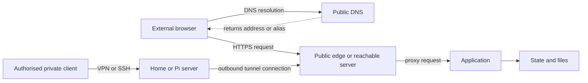

# Local to Internet: connectivity, publishing, and mail

**Official-document research and practical exercise specification, 2026-11-03.** This supports the [DevOps track design](devops-track-design.md) and the expanded Internet Services and Operations curriculum. The [source ledger](local-to-internet-connectivity-sources.json) records 29 first-party references, resolved URLs, retrieval times, response hashes, and access limits. This appendix audits documentation; it does not claim that external tunnels, VPNs, cloud deployments, or public mail delivery were executed during the research.

These subjects cross networking, Linux administration, DevOps, self-hosting, and site reliability engineering. The useful organising question is **how a request reaches a service, what the service depends on, and how to keep that path working**. A learner can assemble and operate these systems independently using free software. Public addresses, DNS control, electricity, reliable storage, provider permissions, and an external relay remain separate dependencies.

## 1. Teach reachability before products

The opening exercise should distinguish four different achievements:

1. A program listens on loopback and another local process reaches it.
2. A different device on the same permitted LAN reaches it.
3. A remote authorised device reaches it through a private network or tunnel.
4. An ordinary external browser reaches a public URL through DNS, routing, and TLS.

Passing one does not establish the others. A public URL also does not mean every network will allow it: an offline device, captive portal, restrictive outbound policy, DNS filtering, or unsupported address family can prevent access. Guest-network client isolation can block access to a nearby LAN server while still allowing access to its public website. Testing from the server itself cannot establish Internet reachability.

DNS answers a naming question; it does not carry the subsequent HTTP request. Teach listening address, port, routing table, firewall state, NAT, address family, TLS name verification, and application status as separate layers. Include packet/flow observations where privileges permit, plus saved traces for learners who cannot install tooling yet.

| Route | Minimum capability and external dependency | What the learner must establish |
| --- | --- | --- |
| Loopback → process | Any supported machine or allocated browser lab with a local service. | Correct bind address, port, process identity, and response. |
| LAN → home server/Pi | A second permitted peer, LAN addressing, a reachable listening interface, and firewall allowance. | Connection from the peer; loopback-only and guest-isolation negative cases. |
| Public IPv4 → home edge | An actually public/routable address, router control, inbound service allowance, and applicable ISP permission. | Forwarding reaches the right internal host; external tests work; administration remains private. |
| Public IPv6 → home edge | Globally routable IPv6, appropriate router/host firewall rules, and IPv6 capability at the client. | AAAA/name/certificate correctness and reachability from an IPv6 peer. IPv4-only clients still need an IPv4-capable edge or another path. |
| VPS → service | Provider account, a usable instance/OS, network allowance, and recovery-console access. | The same service works on a separate host and survives an intentional process/instance restart. A local VM teaches administration but cannot prove a provider's public routing. |
| Home → outbound public tunnel | A supported connector binary, allowed egress, running origin, and reachable provider edge. | Connector health and HTTP behaviour; origin downtime and blocked-egress failures. |
| Private mesh/VPN | Compatible clients or a configured gateway, identity/keys, routes, and a viable direct or relay path. | Only intended members/subnets can reach the service; route and DNS behaviour are understood. |
| Home → self-hosted reverse relay | A reachable relay endpoint or explicitly supported P2P path, authenticated/encrypted transport, and owned port configuration. | Forwarding works through the relay and stops/reconnects truthfully; relay access is restricted. |

Teach CGNAT as a topology constraint. RFC 6598 reserves `100.64.0.0/10` for shared address space [NA1]; private/shared WAN addressing is a strong investigation clue, not a universal test for every carrier's design. Compare the router's WAN address, the observed public egress address, provider information, and IPv6 capabilities. A dynamic-DNS update changes a record; it cannot create an inbound route through CGNAT. An externally tested IPv4 path must not be inferred solely from a working hairpin-NAT connection inside the LAN.

### Virtual-machine guests and host administration are core skills

Creating a guest, publishing its website, and administering the physical host are three connected operations with different permissions. The host/virtualisation curriculum supplies the concrete KVM/libvirt or alternative recipe and resource controls; the networking lesson must make these boundaries visible.

| VM arrangement | Network behaviour to establish | Required practical check |
| --- | --- | --- |
| Guest behind a host NAT network | The guest commonly has outbound connectivity while unsolicited LAN/Internet traffic has no automatic path to it. Exact host-to-guest access depends on the configured virtual network. | Reach the guest from the intended host/peer; show the missing inbound path; add one owned port mapping or reverse-proxy route and inspect where it terminates. |
| Guest on a bridged LAN network | The guest obtains an address on the attached LAN when the bridge, uplink, and network policy support it. This is still not automatically a public Internet address. | Check address assignment, LAN peer reachability, and guest firewall. Compare with guest/client isolation and the host NAT case. Do not assume every Wi-Fi uplink supports ordinary bridging. |
| Public edge → guest website | An authenticated operator configures the public edge to proxy to the guest's stable private address/port, through an allowed host/guest path. | The public hostname reaches the correct guest version; changing the wrong guest/upstream fails; direct guest administration remains subject to its own policy. |
| SSH through a jump host | `ProxyJump` supplies a transport route to a guest [SS1]. Guest login credentials and host/jump permissions remain separate. | A guest administrator can perform the allowed guest operations and cannot use that login as proof of hypervisor/host administration rights. |
| cloudflared inside the guest | The guest owns the connector, credentials, service unit, and origin access. Host reboot stops it; guest restart/recreation also affects it. | Stop/restart the guest and show the corresponding tunnel/website state; preserve or deliberately rotate the connector identity during recreation. |
| cloudflared on the host/edge | The connector has its own lifecycle and routes to the guest over the virtual network. Connector alive does not imply guest healthy. | Stop the guest while leaving the host connector alive; observe the origin failure and recover the guest/route independently. |
| Host CPU/RAM/disk/network management | Hypervisor/API/console authority is separate from guest SSH. Several guests share physical bottlenecks and host failure. | Identify which identity can change allocations and which observations describe the guest versus the host. Keep guest topology, allocation changes, and host capacity evidence separate. |

An institution-provided SSH endpoint identifies an access service, not the underlying hypervisor, ownership model, or physical resource allotment. The learner needs the provider's documentation/console or authorised host-level evidence to establish those facts. A successful guest website deployment cannot by itself verify VM creation or host administration.

## 2. Tool choices grounded in official documentation

### Cloudflare Tunnel and cloudflared

`cloudflared` is the connector program; Cloudflare Tunnel is the managed connection/routing service. The connector initiates an outbound connection, enabling a home or Pi origin without a publicly routable IP to receive traffic through Cloudflare [CF1]. “Outbound-only” describes connection establishment, not one-way data flow.

| Mode | Documented behaviour | Track use |
| --- | --- | --- |
| Quick Tunnel | Temporary `trycloudflare.com` URL; no Cloudflare account or domain required. No uptime guarantee, maximum 200 in-flight requests, no Server-Sent Events, changing hostname after recreation [CF2]. | A first external HTTP demonstration using disposable content. The task ends with connector shutdown and an explanation of the temporary address. |
| Managed public HTTP application | A stable tunnel object plus a hostname route to the origin. Publishing an application does not itself require a paid Access plan; identity-based Access policies are a separate concern [CF3]. | Deploy a controlled public service, configure application/Access authentication where required, and test origin recovery. Use a domain/zone the learner actually controls; a free tunnel does not provide a free registered domain. |
| Private networking | Connect private resources and apply routing/client/policy configuration [CF1]. | Reach an internal service from an authorised device and demonstrate denial for an unapproved device. |
| TCP/SSH through the documented hostname route | TCP/SSH are carried over WebSocket; the documented clients run `cloudflared access tcp` or `cloudflared access ssh`. The docs recommend Client-to-Tunnel for long-lived connections [CF4]. | Compare this access path with ordinary browser HTTPS and direct SSH. Do not describe it as a universally reachable raw TCP listener. |

The connector requires outbound **7844/UDP for QUIC or 7844/TCP for HTTP/2**, along with the documented destinations; port 443 enables some optional features [CF5]. A course should include the failure “local HTTP works, connector cannot reach its edge” and distinguish that from an application failure. Do not advise disabling the entire firewall.

The current public-routing documentation also describes separate Spectrum routing for TCP/UDP [CF3]. That is a different product/capability path whose entitlement and protocol requirements must be checked. The normal free HTTP-tunnel lesson must not promise public SMTP delivery, arbitrary UDP exposure, or automatic load balancing. A tunnel also cannot keep an application running after its host loses power.

### OpenSSH, VPNs, and self-hosted relays

| Tool/path | What to teach | Practical boundary |
| --- | --- | --- |
| OpenSSH | Key creation, host-key verification, named users, client config, `ProxyJump`, local/reverse/dynamic forwarding, keepalive behaviour [SS1], [SS2], [VP1]. | Test `sshd` configuration before applying it and preserve a verified recovery route. A successful SSH transport does not prove that the forwarded application is healthy. |
| WireGuard | Peer public keys, interface addresses, `AllowedIPs`, routes, endpoint/UDP reachability, and NAT keepalive where needed [WG1]. | Free software; the learner supplies nodes and networking. WireGuard alone does not provide a hosted rendezvous/relay service that resolves every restrictive NAT arrangement. |
| Tailscale | Managed coordination, device identity, access policy, direct vs relayed transport, DNS, and route selection [TS1]. | Direct, DERP, and peer-relay connections have different latency/bandwidth characteristics. Measure the actual path. Free-plan numbers are dated below. |
| Tailscale subnet router | A node advertises approved routes to devices behind it; source NAT is enabled by default [TS3]. | Reach a selected home subnet/device without installing a client on each device. Route approval and access policy remain required. Include overlapping-LAN and return-route reasoning. |
| Tailscale exit node | An explicitly selected node carries default-route Internet traffic [TS4]. | This differs from accessing one private subnet. Check egress address, DNS, local-LAN access choice, and behaviour when the exit node stops. |
| Headscale | Self-hosted implementation of the Tailscale control server, aimed at a narrow single-tailnet scope for personal/small open-source use [HS1]. | An advanced ownership exercise. Account for hosting, TLS, client compatibility, updates, policy, backups, and relay choices; the control server does not remove data-path requirements. |
| frp | Public relay/server plus intranet client; supports TCP/UDP/HTTP/HTTPS and additional forwarding/P2P features [FR1]. | The documented straightforward public route requires a node with a public IP. Teach system service, authentication, encryption, allowed listeners, reconnects, and cleanup. |
| rathole | Reverse tunnelling through a public-IP server; per-service tokens, TCP/UDP forwarding, optional Noise or TLS [RA1]. | Explicitly configure authenticated encryption and verify the peer; a service token alone is not encryption. Treat the project's performance claims as claims to benchmark on the learner's hardware. |

Do not disable SSH host verification to make a lesson pass. Use a console or another trusted channel to verify the initial host fingerprint. The SSH server normally binds reverse forwards to loopback; `GatewayPorts`, `PermitListen`, `PermitOpen`, forwarding permissions, and any interactive shell access must be reasoned about together [SS2]. A broadly permitted shell can undermine an assumed forwarding-only restriction.

For a public reverse-SSH website exercise, a clear baseline is **public HTTPS edge → relay loopback port → SSH reverse forward → home application**. This teaches controlled exposure without opening the forwarded listener to every interface. `ExitOnForwardFailure` detects failure to set up a requested listener, but it does not detect every later failure of the destination application [SS1]. Include an application health probe and service-manager restart policy as separate controls.

### Free publishing and actual constraints

The following numbers were inspected on **2026-11-03**. They are curriculum inputs to recheck at release, not permanent offers. Free software, a provider's free allowance, an expiring trial, and a learner-owned machine have different costs and failure modes.

| Choice | Documented allowance or limitation | Appropriate practical lesson |
| --- | --- | --- |
| GitHub Pages | Static hosting; GitHub Free supports Pages from public repositories [GH2]. Published sites ≤1 GB; soft 100 GB/month bandwidth limit; documented commercial/SaaS restrictions [GH1]. | Publish a static portfolio/documentation site, set a relative asset path correctly, use a provider hostname, inspect HTTPS, and redeploy/roll back. A Python/Node process cannot be hosted by treating Pages as a VPS. |
| Cloudflare Pages | Free plan lists 500 builds/month and one concurrent build; builds time out after 20 minutes; asset size limit 25 MiB. Pages Functions consume Workers quotas [PG1]. | Static site and a small supported function, with distinct build/runtime failures. Check the current file-count and function limits for the chosen project. |
| Cloudflare Workers | Free table lists 100,000 requests/day, 10 ms CPU time, 128 MB memory, and six simultaneous outgoing connections per request [WK1]. | Adapt a small stateless endpoint to the supported runtime. CPU time and wall time differ. A serverless request handler is not an always-running OS process or general VPN/mail host. |
| Render Free web service | Sleeps after 15 minutes without inbound traffic; waking takes about a minute. 750 free instance hours per workspace/month; local filesystem is ephemeral; free Postgres expires after 30 days. Free services cannot send on SMTP ports 25/465/587 [RD1]. | Deploy a supported dynamic application, observe a cold start, demonstrate data-loss risk using disposable data, and choose an explicit persistence/retention policy. Do not defeat idle limits with artificial keep-alive traffic. |
| Tailscale Personal | Current pricing lists $0, up to six users, unlimited user devices, up to three ACL groups, and up to 50 tagged resources to start [TS2]. | A small personal mesh and access-policy exercise. Recheck account eligibility, resource definitions, and any plan-specific feature before assuming the same offer serves an organisation. |
| Existing home/Pi/PC hardware | No new compute rental if already owned, but storage, electricity, uplink, maintenance, and sometimes domain/IP costs remain. | Operate the service and measure its real resource cost. No claim of free hardware or uninterrupted availability. |
| VPS or external relay | Provider-specific billing, quotas, IP availability, access controls, and SMTP rules. No unconditional free VPS is established by these sources. | Offer a local-VM equivalent for administration, then a clearly costed optional public deployment. Require a budget and teardown record before opting into paid capacity. |

Teach TLS with the actual validation path. Let's Encrypt HTTP-01 needs the challenge reachable on port 80; DNS-01 verifies a DNS TXT record and supports wildcards [TL1]. DNS-01 can validate a name without inbound access to the origin, but it does not make the eventual service reachable. For offline/private labs use a scoped local CA and explicit trust, then compare with public ACME issuance. Disabling certificate verification is not the successful result of a TLS exercise.

Cloudflare DNS-only records return the origin's address; proxied records direct supported traffic through Cloudflare [DN1]. This distinction matters for SSH and mail as well as HTTP. DNS TTLs, caches, split DNS, stale A/AAAA records, and certificate names deserve concrete failure cases.

## 3. Build, configure, and procure are different skills

| Learner can build | Prefer established software/configuration | Requires an external capability or decision |
| --- | --- | --- |
| Small HTTP application, static site, health/readiness endpoints, release manifest, monitoring probes, runbook, deploy/rollback automation. | Linux service manager, OpenSSH, WireGuard/Tailscale, reverse proxy, ACME client, DNS server/resolver, backup tool. | Publicly reachable address/relay, router/ISP policy, DNS ownership, certificate validation path, external receiver for an end-to-end test. |
| A bounded local TCP forwarder to learn stream copying, framing, connection lifecycle, timeouts, half-close, backpressure, and connection limits. | Standard TLS with peer verification or SSH for authentication/encryption; frp/rathole for a reviewed maintained reverse-tunnel implementation. | A route to an external relay. A custom protocol cannot create connectivity where neither peer has a usable path. |
| Application mail formatting, retry/idempotency behaviour, delivery-status handling, and a local test harness. | Postfix/Dovecot or a maintained integrated mail stack, DKIM tooling, filtering, TLS, mail storage and recovery. | A suitable mail endpoint, usable port 25 for server-to-server mail, domain DNS and PTR control, receiving-provider acceptance. |

A custom-tunnel lesson is a systems-programming branch after the learner has operated OpenSSH/TLS. Its first forwarder stays on loopback/private test interfaces, bounds buffered bytes and active connections, and shuts down cleanly. Compare byte counts, latency, memory, and disconnect behaviour with the standard tool. An optional advanced version adds multiplexed streams and reconnect/session rules using existing cryptography. Passing the toy exercise does not establish that it is suitable for public deployment.

## 4. Practical lab contracts

Every lab should package source/configuration, topology, expected observations, at least one misleading symptom, a failing control, teardown, and a concise evidence template. The following are proposed exercises; the documentation audit is evidence for their mechanisms, not a claim that all exercises have been executed.

| Exercise | Do the work | Pass evidence and required failure/recovery |
| --- | --- | --- |
| **N1 — Four scopes of a web request** | Start Relay on loopback; inspect its socket/process; connect locally; bind to the chosen LAN interface; connect from a second permitted peer; compare public and private addresses. | Retain a labelled flow diagram and response from each claimed scope. A loopback-only bind must fail from the peer. Explain a guest-network or firewall failure without blindly changing the application. |
| **N2 — Name, edge, and certificate** | Use local DNS/hosts entries and a reverse proxy; deliberately create a wrong upstream port and a certificate-name mismatch; repair each separately. Repeat with public DNS/ACME when available. | Correct host, response, and validated certificate; wrong hostname remains rejected. Record which public validation/reachability claims could actually be tested. |
| **N3 — Own a Linux endpoint and its VM path** | Create a guest through the track's virtualisation recipe, then compare NAT and bridged/routed access where supported. Create a non-root service identity, verify SSH keys/host fingerprint, configure a service and guest/perimeter rules, and preserve console access. Validate SSH config before reloading [VP1]. Repeat endpoint operations on an owned VPS/Pi when available. | A new legitimate SSH session succeeds, unwanted access is refused, and the website reaches the correct guest through the intended edge. A reboot preserves intended files. Recover a broken service/upstream, and explain which actions required host privileges rather than guest SSH. |
| **N4 — Three SSH forwarding directions** | Forward a remote private service locally; reverse-forward the home application to a relay's loopback; use a local SOCKS proxy and explain where name resolution occurs; reach an internal node via a jump host. | Draw the listener and final destination for each command. Occupy a requested port and observe setup failure; stop the target and show why transport alive ≠ application healthy. The reverse listener stays private until the explicit public edge is configured. |
| **N5 — Home/Pi publishing choices** | Produce and test a route decision using public IPv4, IPv6, CGNAT, inbound policy, and domain ownership. Apply DDNS only when address changes are the relevant problem. | An independent external peer reaches the claimed public route. If unavailable, demonstrate the closest local equivalent and record the exact unmet prerequisite. Changing DNS alone must not be accepted as solving CGNAT. |
| **N6 — Operate a Cloudflare tunnel** | Run a disposable Quick Tunnel in the learner's environment; then configure a named/public or private route where account/domain prerequisites exist. Manage the connector as a service and distinguish origin logs from connector logs. | External HTTP succeeds; connector stop breaks the path; origin stop produces an origin-related failure; restart recovers. An administrative route requires its intended authentication. Test the documented egress path and identify Quick Tunnel limits [CF2], [CF5]. |
| **N7 — Private access and routing** | Build a two-peer WireGuard lab; extend it to a selected private subnet. Then compare managed Tailscale direct/relay connections, subnet routing, and an opt-in exit node. | Intended peer/subnet succeeds; unapproved peer fails; default Internet egress changes only in the chosen exit-node test. Record observed direct/relay state, return routing, DNS behaviour, and restoration after node shutdown [WG1], [TS1], [TS3], [TS4]. |
| **N8 — Own the relay/control plane** | Optionally replace the managed path with Headscale or a frp/rathole relay. Use the local PC's VMs first; move the public edge to an owned reachable host later. | Recreate configuration from the runbook, reject an incorrect identity/token, use verified encryption, recover after restart, and remove only owned resources. Explain which managed responsibilities moved to the learner [HS1], [FR1], [RA1]. |
| **N9 — Publish on a free allowance** | Deploy a static site and one supported dynamic endpoint; record build/runtime limits; trigger a controlled build error, cold start, or persistence failure using disposable content. | An external browser receives the correct version. The learner explains backend limitations, storage lifetime, quota behaviour, and migration/backup choices. A saved file on ephemeral storage cannot satisfy durable-state requirements [GH1], [GH2], [PG1], [WK1], [RD1]. |
| **N10 — Understand a custom tunnel** | Implement and test a bounded private TCP forwarder, then carry its external leg through standard authenticated SSH/TLS. Inspect stream cancellation, timeouts, backpressure, and reconnect rules. | Byte-for-byte transfer and expected cancellation; limit excess clients; bound memory under a deliberately slow reader; no claim of custom cryptographic assurance. Compare with the standard forwarding implementation. |
| **N11 — Local mail, then an owned mail domain** | Start with application → SMTP capture. Then use isolated MTA/mailbox nodes and a test domain to submit, queue, relay, receive, retrieve, and restore mail. Choose a public extension only after checking the prerequisite sheet below. | Retained message ID/headers plus queue/mailbox evidence; unauthorised relay is refused; receiver outage queues/retries and then recovers; mailbox restore works. Local success and public deliverability have separate evidence [MP1], [MS1], [MS2], [GM1]. |
| **N12 — Survive change and loss** | Interrupt the connector, reboot the origin, change its private address deliberately, expire/replace a test credential, and restore configuration/state from an external copy. | Detect the actual failed dependency, recover the endpoint, preserve required data, and document recovery time. An old green UI indicator or running connector is insufficient. |

The progression supports a Pi, small server, PC, or local VM without changing the mechanism being learned. The Pi adds ARM/package compatibility, boot/power/storage observations and physical network placement. A VPS adds public-provider routing and recovery-console experience. A larger PC enables multiple independent nodes and failure domains within a lab; those VMs still share one physical host.

A learner without a suitable device can begin with real saved traces, browser editors, topology exercises, and an allocated restricted environment. Those activities can verify reasoning or the specific allocated task. Physical reboot, a home router, ARM behaviour, unrestricted VPN setup, and public-provider routing require the corresponding later environment. Preserve the completed reasoning and direct learners to the missing practical operation when equipment becomes available; do not require repeating a course or claim an unperformed operation was verified.

## 5. Mail deserves its own operational branch

Mailpit is an SMTP capture/development tool with a viewer and testing API [MP1]. It is suitable for validating application emails without involving external recipients. It does not by itself demonstrate an Internet mail service or IMAP mailbox operations.

An isolated full-mail exercise can use Postfix for SMTP transfer/queueing and Dovecot for mailbox retrieval/authentication, directly or through a pinned Docker Mailserver release. The project's introduction explains the separate mail-server components; its basic example supplies persistent mail/state/config/log locations and explicit SMTP/IMAP ports [MS1], [MS2]. Review the selected version instead of copying an unpinned Compose file. Scanner/indexing components alter resource demand; a large integrated default is not the only way to learn SMTP and IMAP.

| Concept | Mechanism the learner must demonstrate |
| --- | --- |
| Submission vs transfer vs retrieval | A client submits to an authenticated service; MTAs transfer mail using SMTP; the recipient reads the stored mailbox with IMAP. Distinguish ports 587/465, server-to-server port 25, and IMAPS 993. |
| Envelope vs visible headers | `MAIL FROM`/recipient envelope, `From` header, return/bounce path, message ID, and the actual routing/queue record. |
| MX and A/AAAA | The receiving domain's MX points to a mail hostname whose address leads to the intended receiving endpoint. A website's HTTP route is a separate service. |
| SPF | DNS policy identifies permitted senders for the relevant envelope identity. It is not end-to-end message encryption or a universal guarantee of acceptance. |
| DKIM | A private key signs selected message material and DNS publishes verification information. Preserve/rotate keys and test a changed message. |
| DMARC | Align the visible author domain with a passing SPF or DKIM identity and publish the intended reporting/policy. Begin with a reviewed reporting policy before enforcing a stricter one. |
| PTR and identity | A suitable provider controls reverse DNS for the sending address. Record the forward/reverse relationship and the SMTP identity. A registrar TXT record cannot change an IP provider's PTR record. |
| Queue, retry, abuse controls | Receiver downtime, bounded retry, rejected unauthorised relay, rate limits, and log review. An SMTP acceptance response does not guarantee inbox placement. |
| State and recovery | Restore mailboxes, identities, configuration, and necessary keys from a separate backup; verify retrieval and permissions afterward. |

Google's sender guidance requires SPF **or** DKIM and valid forward/reverse DNS for ordinary senders, alongside TLS and other conditions; its bulk-sender requirements add SPF **and** DKIM plus DMARC and additional rules [GM1]. Teach SPF, DKIM, and DMARC together without incorrectly presenting every bulk-sender rule as the universal minimum for one test message.

Before choosing a **real public mail extension**, the learner must establish domain control, an appropriate reachable endpoint, inbound/outbound server-to-server SMTP allowance or an explicitly designed relay arrangement, PTR control where required, certificate/hostname correctness, backup capacity, and an external recipient they control or have permission to use. Provider restrictions are concrete: DigitalOcean's current documentation says SMTP ports **25, 465, and 587 are blocked by default on Droplets** [VP2]; Render's free-service restrictions also block those outbound ports [RD1]. This rules out promising that any cheap/free VPS will work.

A home server can hold mailboxes behind a suitably designed public mail relay, but the relay remains infrastructure with its own delivery responsibilities. Neither DDNS nor a normal public HTTP tunnel removes port/reputation/identity requirements. IP reputation and recipient filtering remain external decisions even after configuration is correct. A learner can complete the full protocol/administration lab locally and later add public evidence without relearning SMTP from another course.

## 6. Authoring and verification requirements

Use explicit capability prerequisites instead of inventing a universal minimum RAM number for “VPN” or “VPS.” A kernel/interface-capable Linux node, a supported binary architecture, controlled networking, a reachable peer, permission to change routes, and a recovery path are different requirements. Rootless containers can be useful for application tests but do not automatically provide every kernel-networking operation in the VPN curriculum.

For each authored exercise, record its tested OS/version/architecture, fixed tool versions, VM/container permissions, node count, network topology, peak RAM/CPU/disk activity, elapsed setup time, and required external account/domain/policy. Resource envelopes remain proposed until the actual scenario is measured. Include a lightweight configuration and an expanded topology where the mechanism warrants it; do not infer supported throughput from a product's minimum installation footprint.

Keep evidence levels distinct: supplied-trace analysis, learner-local observation, reproducible submission, and trusted lab observation. A screenshot or self-reported public URL is weaker than replayable configuration plus a controlled independent probe. Exercise completion, public-provider reachability, performance under load, and ongoing availability are separate claims.

This appendix establishes documentary credibility for the design. Full curriculum validation still needs version-pinned lab execution, negative-control tests, hardware/network variants, and task-based sessions with learners. Revisit provider limits and documentation before publishing a lesson that depends on them.

[CF1]: https://developers.cloudflare.com/cloudflare-one/networks/connectors/cloudflare-tunnel/
[CF2]: https://developers.cloudflare.com/tunnel/get-started/quick-tunnels/
[CF3]: https://developers.cloudflare.com/cloudflare-one/networks/connectors/cloudflare-tunnel/routing-to-tunnel/
[CF4]: https://developers.cloudflare.com/cloudflare-one/networks/connectors/cloudflare-tunnel/routing-to-tunnel/protocols/
[CF5]: https://developers.cloudflare.com/cloudflare-one/networks/connectors/cloudflare-tunnel/configure-tunnels/tunnel-with-firewall/
[WG1]: https://www.wireguard.com/quickstart/
[TS1]: https://tailscale.com/docs/reference/connection-types
[TS2]: https://tailscale.com/pricing
[TS3]: https://tailscale.com/docs/features/subnet-routers
[TS4]: https://tailscale.com/docs/features/exit-nodes
[HS1]: https://headscale.net/stable/
[SS1]: https://man.openbsd.org/ssh_config
[SS2]: https://man.openbsd.org/sshd_config
[VP1]: https://ubuntu.com/server/docs/how-to/security/openssh-server/
[DN1]: https://developers.cloudflare.com/dns/proxy-status/
[TL1]: https://letsencrypt.org/docs/challenge-types/
[GH1]: https://docs.github.com/en/pages/getting-started-with-github-pages/github-pages-limits
[GH2]: https://docs.github.com/en/pages/getting-started-with-github-pages/what-is-github-pages
[PG1]: https://developers.cloudflare.com/pages/platform/limits/
[WK1]: https://developers.cloudflare.com/workers/platform/limits/
[RD1]: https://render.com/docs/free
[MP1]: https://mailpit.axllent.org/docs/
[MS1]: https://docker-mailserver.github.io/docker-mailserver/latest/introduction/
[MS2]: https://docker-mailserver.github.io/docker-mailserver/latest/examples/tutorials/basic-installation/
[GM1]: https://support.google.com/a/answer/81126
[NA1]: https://www.rfc-editor.org/info/rfc6598/
[VP2]: https://docs.digitalocean.com/support/why-is-smtp-blocked/
[FR1]: https://gofrp.org/en/docs/overview/
[RA1]: https://raw.githubusercontent.com/rapiz1/rathole/main/README.md
