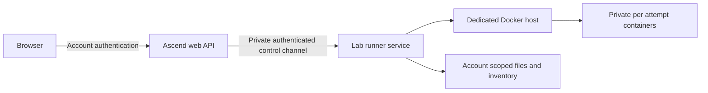

# Browser labs on a separate server runner

The Linux catalog uses brief cards; `#lab/REFERENCE` opens a task page, and
`#lab/RECIPE` selects a particular exercise. Local CLI execution remains
available. A configured runner adds browser launch, bounded file editing,
HTTP requests to fixed lab targets, and a restricted FRR console.



The web app receives no Docker socket, host execution permission or arbitrary
shell endpoint. The runner is an administrative service on a dedicated Linux
x86-64 host or VM. Its reviewed adapters provide pinned downloads/images,
internal target networks, fixed loopback proxies, resource limits and owned
cleanup. Docker 28 or later is required. The router API accepts complete,
allowlisted BGP commands on the learner router only; it never exposes a general
shell or edits to the external control routers. Saving with `write memory`
resets the owned BGP sessions on both sides so authentication uses fresh sockets
without changing the external control rules. The HTTP console accepts relative paths
on the run's fixed endpoints, refuses redirects and CONNECT, and renders returned
content as text rather than executing target HTML in Ascend's origin.

Account scopes derive from a shared secret, stable installation ID and the
account ID selected by Ascend's authentication dependency. Browser input cannot
choose a scope. The runner authenticates every request and looks up run IDs only
inside that scope. Keep its raw API private. Remote control channels require
HTTPS; unencrypted HTTP is accepted only on loopback. Single-user Ascend has no
login, so use multi-user authentication for shared access.

## Capacity for an 80 GB free host

80 GB is the deployment planning budget, not a claim that all candidate VM,
cluster and model environments fit or have passed validation. Start with two
active account slots, a two-hour absolute deadline, no warm pool and a 10 GiB
free-space reserve. Each account gets one active run; stopped and failed-cleanup
runs retain the slot. Setup, checks and mutations execute through one worker,
while status polling stays responsive. A queued operation survives in a manifest;
a restart marks interrupted jobs failed and reconciles resource inventories
before accepting new work. Expiry cleanup runs every 30 seconds between
operations; reviewed container launchers also enforce their own deadlines.

Plan for at least 8 GB RAM and four CPU cores for two of the currently reviewed
container recipes plus the web process and host. This is a conservative starting
allocation, not a measured maximum. Container limits apply separately from the
runner service's memory limit. Reserve about 20 GB for OS, images, logs and safety,
20 GB for current labs and retained submissions, and leave about 40 GB for one
future specialist environment after measuring its actual requirements. Keep
Docker storage and runner files on the capacity-planned filesystem. Provisioning
checks both provider capacity and recipe requirements; the controller applies
its reserve to runner storage. Protect separate provider filesystems with their
own operator quota/watermark. Never evict images still used by other runs.

The seven allowlisted recipes are audit discovery, VAmPI ownership, the JSON
BGP export model, WrongSecrets basics, and the three real FRR BGP exercises.
The eight larger learner-managed environment plans remain available. Adding
VM/cluster/cloud/emulator/model launchers requires that environment's concrete
pins, infrastructure identity, access route, quota, negative controls and teardown
evidence. AWS also needs an account and spending scope; local disk does not
provide these. No catalog edit enables arbitrary upstream launch scripts.

## Install and connect

On the dedicated runner, install this checkout and Docker 28+, then create a
service account with access to that dedicated Docker daemon:

```sh
python3 -m venv /opt/ascend-runner/.venv
/opt/ascend-runner/.venv/bin/pip install -e '/opt/ascend-runner[server]'
sudo useradd --system --home /var/lib/ascend-runner --create-home ascend-runner
sudo usermod -aG docker ascend-runner
sudo install -o ascend-runner -g ascend-runner -d /var/lib/ascend-runner
sudo install -m 600 deploy/runner.env.example /etc/ascend-runner.env
# Fill ASCEND_RUNNER_KEY with a generated random secret.
sudo install -m 644 deploy/ascend-lab-runner.service /etc/systemd/system/
sudo systemctl daemon-reload
sudo systemctl enable --now ascend-lab-runner
```

The unit binds `127.0.0.1:8421`. Run exactly one service process for each runner
home. For a native Ascend process on that same administrative host, set:

```dotenv
ASCEND_RUNNER_URL=http://127.0.0.1:8421
ASCEND_RUNNER_KEY=<the same private secret>
ASCEND_RUNNER_SITE_ID=<a stable unique ID for this Ascend installation>
```

For a separate runner VM, or an Ascend container, route to the runner through a
private TLS reverse proxy and use an HTTPS URL. A container's loopback belongs
to the container. Do not publish the raw runner API or add a Docker socket to the
Ascend web container. The main Compose file forwards these three settings from
its private `.env`; restart/recreate the web process after changing them.

Open a reviewed recipe under Playground → Linux labs and select **Launch on
server**. Save edited work before checking. **Stop lab** retains its deadline,
configuration and slot. **Finish & keep work** exports before destruction;
export failure keeps the runtime. **Destroy runtime** releases compute without
requiring a passing submission. Failed cleanup keeps inventory and exposes
**Retry cleanup**. **Download saved work** retains small files and the runner's
observed result. Checks award zero XP and no verified track completion; they
measure the named rubric or live controls, not independent solving.

## Deployment acceptance

Run the following from the checkout on the intended runner host. It starts
disposable web/runner processes, uses real pinned downloads, exercises the
browser and checks lifecycle/results. The verification's zero reserve allows
this workstation to test the small recipes; production retains 10 GiB.

```sh
.venv/bin/python scripts/verify_hosted_labs.py --record /tmp/hosted-labs.json
.venv/bin/python scripts/verify_hosted_labs.py --all --record /tmp/hosted-labs-all.json
```

The first command tests the two file/policy recipes. `--all` adds actual Docker
services and BGP. It only cleans its owned runs and images that its disposable
profiles acquired; preexisting provider resources remain untouched. Keep the
JSON output and log as evidence. Larger environments use their existing
`ascend local-lab prepare ID` workspace and read-only collectors; submit the
small exported observations for interpretation rather than VM disks, credentials,
Terraform state or model weights.
