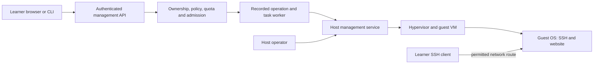

# Virtualization control planes: from a student portal to a running VM

**Focused documentary audit, 2026-11-03.** Four existing solutions were compared through 12 first-party references. The [source ledger](virtualization-control-plane-sources.json) records retrieval dates, canonical URLs, response hashes, and access limitations. These are documented product capabilities and interaction structures; authenticated dashboards, provisioning, backup restoration, and load behaviour were not exercised during this audit.

This extends the [connectivity design](local-to-internet-connectivity-notes.md) and [device/capacity lab design](local-to-internet-capacity-labs.md). It supplies the management-platform comparison for the broader sequence of infrastructure tracks.

## What an institution-style VM portal actually does

A web portal receives a request to create a machine. Its backend authenticates the user, checks their role and allowance, selects an image and placement, and asks a host-side virtualization service to create/start the guest. The hypervisor provides virtual CPU, memory, disks, and network interfaces. Inside that guest, an ordinary operating system can run SSH and a website.

The learner's laptop therefore needs an SSH client or browser to use an already-running remote VM. A desktop VMware application on that laptop is unnecessary. Someone still operates the physical host, hypervisor, storage, network, images, and control plane. An SSH endpoint alone cannot establish whether the institution uses KVM, VMware, another hypervisor, a container, or bare metal.

Guest administration, ownership of a VM through a project API, and administration of the physical host are different rights. A guest's `root` account does not automatically give access to the host's VM definitions or resource allocation. Conversely, a powerful host-management socket can give much broader rights than its surrounding web page suggests.

## Four existing implementations

| Solution | Documented architecture and management pattern | Fit for the curriculum and what needs explicit design |
| --- | --- | --- |
| **Proxmox VE** | Integrated host/cluster platform managing QEMU/KVM VMs and LXC containers. The guide documents a browser interface, API, roles/ACLs, authentication realms, resource pools, templates/clones, cloud-init, storage/network management, task histories, and backup/restore [PV1]. | Strong reference for a dedicated lab host and an operator dashboard. Teach pool/role ownership, approved templates, task logs, and restoration. The cited pool documentation describes permission grouping; it does not by itself demonstrate the particular aggregate student quota policy Ascend needs. Prove that policy through the chosen integration. Free AGPLv3 software and no-subscription repositories are available; the enterprise repository requires a subscription and receives the vendor's stronger validation [PV1], [PV2]. |
| **Incus** | A Linux system-container and VM manager built around a REST API. Projects can isolate instances and selected images/profiles/networks/storage; confined projects and restricted certificates support multiple users [IC1], [IC2]. Project configuration exposes aggregate CPU/memory/disk/count limits and sensitive-feature restrictions [IC4]. | Particularly useful for learning a small private-cloud API and project isolation on a supported Linux host. Explicitly create a **VM** when teaching a separate guest kernel; a container exercise cannot satisfy that outcome. Full local daemon/incus-admin access can become host-root access, so learners need actual confinement rather than a hidden UI button [IC1], [IC2]. Use a supported pinned release and verify QEMU/kernel/architecture requirements [IC3]. Incus identifies its licence as Apache 2 [IC1]. |
| **OpenStack Nova + Horizon** | Nova's API/scheduler/compute services coordinate instances and resource placement; projects, images, networking, identity, and optional persistent block storage involve multiple services [OS1]. Horizon's launch flow exposes project, source/image, flavor, networks, security groups, key pair, and configuration; instance rows show status, task, power state, and addresses [OS2]. Quotas are enforced through version-dependent control-plane mechanisms [OS3]. | Best as a later private-cloud/operations track and the reference for an institution-style learner portal. Teach project roles, flavors, quotas, network access, failed builds, and service dependencies. An all-in-one lab still has multiple service responsibilities; this audit establishes no comfortable fit on a 4–8 GB server or the learner's 16 GB PC. Read-only fixtures can precede a correctly sized practical deployment. |
| **Cockpit Machines + libvirt** | A browser application for creating, running, and managing VMs [CP1]. Its project README identifies libvirt-dbus for enumeration, status notifications and lifecycle operations, and virt-install/virt-xml for creation and definition changes [CP3]. Cockpit normally works with the user's OS privileges and may escalate through polkit/sudo [CP2]. | A useful early, lightweight interface over the same single-host mechanisms learners inspect with CLI tools. It is an operator interface, not documentary proof of a ready-made tenant quota/ownership portal. OS/libvirt policy must match the intended learner role. Validate the installed version's template, snapshot, network, and resource-edit features rather than assuming that every capability of libvirt is present in the UI. |

The initial practical path should use one primary host stack, such as supported Linux with KVM/libvirt and optional Cockpit. Reuse the same guest, application, and evidence when introducing an Incus project or a dedicated Proxmox host. OpenStack belongs after learners understand those responsibilities and have the environment to operate its services. The alternatives teach transferable mechanisms; installing all four before deploying a first website would not establish additional understanding.

Proxmox's current guide lists x86_64 hosts and aarch64 specifically on NVIDIA Grace Hopper/Vera platforms [PV1]. That statement does **not** establish Raspberry Pi support. A Pi can be a management client, SSH endpoint, application origin, or an appropriately supported alternative host. Incus's current **main/development** requirements list kernel 6.12 and QEMU 8.2 for VMs; the Go/RAM build guidance is about compiling Incus, not a universal VM runtime requirement [IC3]. Pin a supported release and distinguish build, daemon, guest, and workload requirements.

## Patterns to adopt for the course's management interface

The proposed workflow can take ideas from these systems while making the learner's responsibilities clear:

1. **Select the correct project and identity.** Show whose resources and quota are being used. Guest SSH credentials and the portal session are separate identities.
2. **Choose an approved image and initial shape.** Show CPU, memory, root-disk allocation, architecture, and the expected workload. A flavor is a resource bundle, not a promised requests-per-second figure.
3. **Choose a network and access method.** Explain private address, NAT/bridge/routing, firewall/security group, key pair, and whether an external route already exists. An allocated VM can run successfully while remaining unreachable from the learner's network.
4. **Validate and admit the request on the server.** Check ownership, permitted image/device options, per-project quota, aggregate host capacity, and conflicting operations. Two simultaneous requests must not each reserve the same remaining capacity.
5. **Show the recorded operation.** Display image/clone work, allocation, boot, configuration, and any failure. Preserve an operation ID and useful logs. “Request accepted,” “VM running,” “SSH ready,” and “website healthy” are separate observations.
6. **Give an explicit connection instruction.** Use the actual assigned host/address/port, key identity, and any jump host. A browser console is a recovery mechanism when guest networking or SSH is broken.
7. **Change allocations deliberately.** Distinguish requested, configured-next-boot, and currently active values. Explain when guest support or a restart is needed. Retain the previous known configuration for recovery.
8. **Retain evidence, back up, and release.** Verify the restore path and show which disks, snapshots, IPs, and reservations remain. A completed deletion request must not be confused with confirmed removal of owned resources.

Proxmox task records provide a concrete model: operations have a unique task identifier (UPID), status, and readable logs [PV1]. Horizon also exposes task and power state separately [OS2]. Adopt that separation rather than deriving backend state from the last button clicked. Incus's documented REST API and project restrictions provide a useful comparison for enforcing a selected project [IC1], [IC2], [IC4].

## CPU, memory, storage, and network controls are different contracts

| Control | What the learner must explain and demonstrate |
| --- | --- |
| CPU | Assigned vCPU count, host physical/logical CPU capacity, scheduling/weight/capping choices, and actual workload use. CPU overcommit does not create physical cores. |
| Memory | Host reserve, per-guest allocation/limit, current consumption, and optional ballooning/hotplug support. A configured increase may require guest support or a restart; it is not equivalent to an observed live allocation. |
| Disk | Virtual disk capacity, physical storage consumption, thin provisioning, snapshot growth, filesystem/partition growth, I/O latency, and backup space. Enlarging a virtual disk alone may not enlarge the guest filesystem. |
| Networking | Virtual NIC, host virtual network, guest IP, routes, guest firewall, host/cloud perimeter, and optional public edge. Bandwidth limits and packet processing are separate from allocating a second vCPU. |
| Project quota | Limits on aggregate permitted allocations/counts, separate from physical free capacity. Incus explicitly notes that many aggregate limits sum configured instance limits rather than current use; its disk accounting also includes applicable volumes/images [IC4]. |
| Images and cloud-init | A reusable OS base plus per-instance identity, keys and configuration. Proxmox documents applying network/SSH settings through cloud-init [PV1]; Horizon offers key-pair and customization inputs [OS2]. Demonstrate unique guest identity and inspect failed initialization. |
| Backups and snapshots | A restorable copy with the required configuration/state, not merely the existence of a snapshot object. Source/target failure domains and application consistency remain relevant. Test restoration to another disposable guest and verify its data/service. |
| Credentials and roles | Learner access to owned resources, an operator's host rights, and scoped automation credentials. Proxmox's privilege-separated API tokens intersect token and user permissions [PV1]; Cockpit follows backend OS privileges [CP2]. |

A front end can guide valid choices and explain limits. It cannot enforce these contracts against a direct API call, stale page, second session, or compromised client. Authorization must occur at the management API and the daemon/service boundary, with identities scoped to the intended resources. Keep privileged management credentials out of learner JavaScript and avoid granting direct full-access sockets as a shortcut to making the interface work.

## Practical acceptance slice for the track sequence

The first complete exercise should produce **two independently identified guests**, each running a small website, plus the host-side configuration and a working recovery record. Use the device/capacity design to choose safe node sizes and the connectivity design for guest NAT/bridge and public-edge routing.

| Check | Passing observation | Deliberate failure or recovery |
| --- | --- | --- |
| Create and identify | The host reports the owned guest definition, allocated resources and volume; the guest reports its own identity and release. | A missing image or invalid configuration fails with a retained task reason. A second create does not silently overwrite the first guest. |
| Reach the website | A permitted peer reaches the correct guest/site through the documented route. | Wrong upstream/guest firewall fails while the VM remains running; the learner repairs the actual path. |
| Resize | The host definition and guest's observable state agree after any required restart and filesystem operation. | An over-quota request is rejected without partial allocation or damage to another guest. |
| Share the host | The learner can inspect/change allowed resources in their own scope. | Another learner/project cannot view its private console, keys or disks or alter its allocations through a direct backend request. |
| Back up and restore | A new disposable guest restores the required website/data/configuration and passes application checks. | The source guest is stopped during verification, proving the restored result is being used. |
| Release | The selected guest and its intended owned storage/network reservations are removed or retained exactly as declared. | A cleanup failure remains visible and accounted for; unrelated images/guests survive. |

These tests are proposed course gates. The audit has not run them against any platform. Later tracks extend the same model to scheduling across hosts, shared/distributed storage, migration, quotas at scale, and the failure of control-plane services. Larger equipment enables those deployments; earlier mechanism and evidence work should remain credited.

## Evidence and version limits

The sources support a credible architecture and teaching pattern, not a guarantee that a particular institution uses one of these products. Source URLs under `latest` or `main` are moving references; course releases must pin their supported versions and retain expected API/configuration behaviour.

Proxmox documents no-subscription packages for testing/non-production and recommends the subscription enterprise repository for its stronger testing/validation [PV2]. This distinction is about repositories/support, not a claim that the software licence requires a paid subscription. Incus's Apache 2 licence is explicitly stated by the project [IC1]. Neither statement supplies hardware, public addresses, electricity, backup storage, or operational support for free.

OpenStack's quota documentation discusses changing quota drivers and unified limits [OS3]; avoid copying legacy settings into an unspecified release. Cockpit's old privileges URL returned an HTML redirect to the current documentation host, which was followed and inspected. Its earlier guessed virtual-machine guide URL returned 404; the official application catalog and project README supply the cited capability/architecture evidence instead. No claim is made about UI details that these documents do not show.

[PV1]: https://pve.proxmox.com/pve-docs/pve-admin-guide.html
[PV2]: https://pve.proxmox.com/wiki/Package_Repositories
[IC1]: https://linuxcontainers.org/incus/docs/main/
[IC2]: https://linuxcontainers.org/incus/docs/main/explanation/projects/
[IC3]: https://linuxcontainers.org/incus/docs/main/requirements/
[IC4]: https://linuxcontainers.org/incus/docs/main/reference/projects/
[OS1]: https://docs.openstack.org/nova/latest/admin/architecture.html
[OS2]: https://docs.openstack.org/horizon/latest/user/launch-instances.html
[OS3]: https://docs.openstack.org/nova/latest/admin/quotas.html
[CP1]: https://cockpit-project.org/applications.html
[CP2]: https://docs.cockpit-project.org/cockpit-guide/latest/guide/privileges.html
[CP3]: https://raw.githubusercontent.com/cockpit-project/cockpit-machines/main/README.md
